# KONSENA AI — Complete Page-by-Page UI/UX & Functional Flow

**Versi:** 3.0 · **Tanggal:** 7 November 2026 · **Status:** spesifikasi implementasi, bukan aplikasi terbangun  
**Platform:** Android-first (Flutter + Kotlin) · **Pendekatan:** offline-first, guest-first · **ONNX:** fase integrasi terakhir

> Dokumen ini adalah turunan terperinci dari `PRD_KONSENA_AI_MOBILE.md`. Identitas halaman **S00–S23** dipertahankan dari PRD induk dan **S24–S39** merupakan perluasan untuk menyelesaikan navigasi page-by-page tanpa halaman yatim. Semua contoh UI adalah spesifikasi, **bukan** laporan model yang telah dilatih. Tidak boleh membuat prediksi/risiko/dark-pattern palsu sebelum ONNX benar-benar siap.

## A. Tujuan dan batas produk

1. Rincikan navigasi dari **splash** sampai **seluruh fitur** KONSENA AI dengan route stabil, CTA, state, kondisi kosong, recovery, dan penanda fase pengerjaan Claude Code.
2. Semua fitur dari percakapan dipertahankan: Audit Izin Android, Privacy Policy Scanner, Terms of Service, Live Camera-to-Laptop Scroll-to-Scan, ConsentGap AI, Dark Pattern Detector, Privacy Risk Analysis, Evidence Explorer, Smart Privacy Recommendation, riwayat, laporan PDF, dan cloud opsional.
3. Live Camera memotret **layar laptop secara fisik** dari kamera smartphone; pengguna scroll di laptop. Fitur ini bukan MediaProjection atau screen recording ponsel.
4. Inspeksi Android hanya membaca paket yang terlihat oleh OS; tidak mengubah izin aplikasi lain secara otomatis.
5. Terms of Service tidak selalu sama dengan Privacy Policy. Persandingan dengan izin Android harus mengecek asosiasi dokumen, versi, dan relevansi klausul.
6. Model dataset Kaggle disiapkan terpisah, dan file ONNX baru masuk ketika seluruh fitur non-ML stabil.

### Navigasi global

- **Bottom navigation (5):** Beranda (`/home`), Audit Baru (`/audit/new`), Pindai (`/scan`), Riwayat (`/history`), Profil (`/profile`). Aksi Pindai menonjol di tengah. S21 Profil tetap dapat dibuka tanpa akun.
- **Settings:** melalui tab Profil dan ikon kanan atas menuju `/settings`; submenu Login/Account opsional, Sync, Data Controls, About.
- **Audit Workspace** adalah pengikat berbagai sumber: permission snapshot, policy/terms, dan screenshot consent.
- **State management:** Flutter BLoC/Cubit. Semua halaman berbagi session ID dan persist draft secara lokal. Child route menjaga draft saat back.
- **Source-first:** pengguna boleh memulai dari jenis sumber mana pun. Tidak ada paksaan login maupun kelengkapan semua jenis sumber.

## B. User flow keseluruhan dari Splash hingga laporan

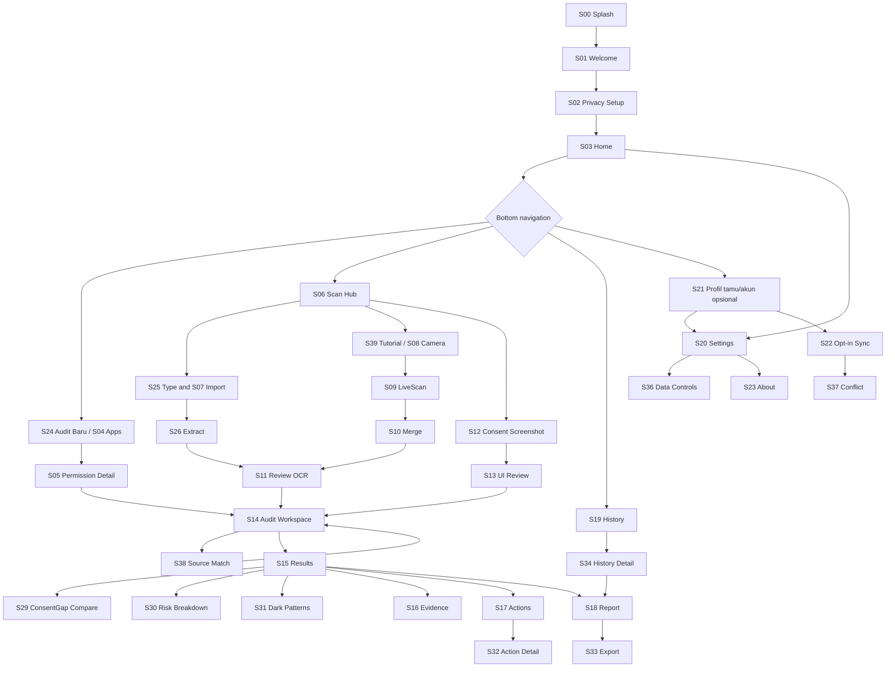

### Urutan perjalanan pertama kali (happy path)

1. **S00 Splash** memuat migrasi DB dan preferensi, lalu **S01 Welcome** pada instalasi pertama.
2. **S02 Privacy Setup** memberi informasi local-first; pilih lanjut sebagai tamu, tidak perlu minta kamera sekarang.
3. **S03 Home** membuka **S24 Buat Sesi Audit** atau langsung shortcut **S06 Scan Hub**.
4. Pengguna dapat masuk **S04–S05** untuk audit izin, **S25–S26–S11** untuk PDF/teks, **S39–S08–S09–S10–S27–S11** untuk LiveScan, dan **S12–S13** untuk screenshot consent.
5. Seluruh sumber dapat ditambahkan ke **S14 Audit Workspace**; sumber tidak cocok ditinjau pada **S38**.
6. **S15 Results** menampilkan fakta/sumber dulu, sedangkan hasil ML **unavailable** sebelum ONNX. Setelah model ada, pengguna bisa meninjau **S29 ConsentGap**, **S30 Risk**, **S31 Dark Pattern**, **S16 Evidence**.
7. **S17–S32** menyediakan rekomendasi dan tindakan; **S18–S33** menyiapkan PDF/share; **S19–S34** menyimpan dan melanjutkan riwayat.
8. **S20–S23, S36–S37** menangani pengaturan, akun, sinkronisasi opt-in dan konflik tanpa menghalangi penggunaan offline.

## C. Modul fungsional: yang ada dan yang belum mengandalkan ONNX

| Modul | Halaman terkait | Sebelum ONNX (nyata) | Sesudah ONNX |
|---|---|---|---|
| Onboarding & consent | S00–S03 | Setup, guest, preferensi | Sama |
| Audit Izin Android | S04–S05, S24 | PackageManager, snapshot, Settings Intent | Sumber ConsentGap |
| Privacy Policy Scanner | S06–S07, S11, S25–S26, S28 | Impor PDF/image/text, OCR, edit, sections | Klasifikasi klausul |
| Live Camera-to-Laptop | S08–S11, S27, S35, S39 | Kamera, ROI, scroll stitching, gap review | Pemrosesan teks oleh NLP |
| Screenshot consent | S12–S13 | Impor, crop, elemen manual | Dark Pattern Detector |
| Audit source join | S14, S38 | Gabung sumber, cek kesesuaian | Retrieval klausul relevan |
| ConsentGap AI | S15, S29 | Status model belum tersedia | Hasil model + bukti jika valid |
| Privacy Risk Analysis | S15, S30 | Fakta izin/sumber; tanpa skor AI | Rubric tervalidasi |
| Evidence-Based Explanation | S16, S28 | Kutipan OCR/sumber asli | Evidence temuan model |
| Smart Recommendations | S17, S32 | Aturan faktual + OS Settings | Saran dikaitkan findings |
| Riwayat & laporan | S18–S19, S33–S34 | Persist lokal, PDF, share, delete | Tambah hasil terverifikasi |
| Akun / sync / security | S20–S23, S36–S37 | Opsional Supabase + RLS | Sama |

## D. Indeks seluruh halaman dan route

| ID | Halaman | Route | Fase | Root/child |
|---|---|---|---|---|
| S00 | Splash Screen | `/splash` | 00–01 | Root/tab |
| S01 | Welcome / Onboarding | `/welcome` | 01 | Child |
| S02 | Privacy Setup dan Persetujuan Data | `/privacy-setup` | 01 | Child |
| S03 | Beranda / Home Dashboard | `/home` | 01–02 | Root/tab |
| S04 | Pilih Aplikasi Android | `/audit/apps` | 03 | Child |
| S05 | Detail Izin Aplikasi | `/audit/apps/:package` | 03 | Child |
| S06 | Scan Hub / Pilih Sumber | `/scan` | 01 | Root/tab |
| S07 | Impor PDF / Gambar / Teks | `/scan/import` | 04 | Child |
| S08 | Persiapan Kamera LiveScan | `/scan/camera/setup` | 05 | Child |
| S09 | LiveScan — Tangkap Saat Pengguna Scroll | `/scan/camera/live` | 05 | Child |
| S10 | Penggabungan / Rekonstruksi Dokumen | `/scan/camera/merge` | 05 | Child |
| S11 | Review dan Koreksi Hasil OCR | `/scan/review/:docId` | 04–05 | Child |
| S12 | Impor Screenshot Persetujuan | `/consent-ui/import` | 06 | Child |
| S13 | Review Elemen UI Persetujuan | `/consent-ui/review` | 06 | Child |
| S14 | Audit Workspace / Gabungkan Sumber | `/audit/:id/sources` | 02,06 | Child |
| S15 | Pusat Hasil Analisis dan Status | `/audit/:id/results` | 06,09 | Child |
| S16 | Evidence Explorer / Bukti Detail | `/audit/:id/evidence/:evidenceId` | 06,09 | Child |
| S17 | Privacy Action Center / Daftar Rekomendasi | `/audit/:id/actions` | 06,09 | Child |
| S18 | Laporan Audit / Preview | `/audit/:id/report` | 07 | Child |
| S19 | Riwayat Audit | `/history` | 02,07 | Root/tab |
| S20 | Settings / Pengaturan Privasi | `/settings` | 01,07 | Child |
| S21 | Profil tamu / Akun opsional | `/profile` | 01,07 | Root/tab |
| S22 | Pilih Data untuk Sinkronisasi | `/sync` | 07 | Child |
| S23 | Tentang / Batasan / Kebijakan KONSENA | `/about` | 01 | Child |
| S24 | Buat Sesi Audit Baru | `/audit/new` | 01,02 | Root/tab |
| S25 | Pilih Jenis Dokumen | `/scan/document-type` | 04 | Child |
| S26 | Progres Ekstraksi Berkas | `/scan/import/progress` | 04 | Child |
| S27 | Pemeriksaan Bagian Terlewat LiveScan | `/scan/camera/gaps` | 05 | Child |
| S28 | Dokumen / Klausa dan Sumber | `/document/:docId/clauses` | 04,09 | Child |
| S29 | ConsentGap Compare — Izin vs Kebijakan | `/audit/:id/compare` | 06,09 | Child |
| S30 | Privacy Risk Breakdown | `/audit/:id/risk` | 09 | Child |
| S31 | Dark Pattern Findings | `/audit/:id/dark-pattern` | 06,09 | Child |
| S32 | Detail Rekomendasi dan Tindakan | `/audit/:id/actions/:actionId` | 06,09 | Child |
| S33 | Ekspor / Bagikan Laporan | `/audit/:id/report/export` | 07 | Child |
| S34 | Detail Riwayat / Resume Audit | `/history/:auditId` | 07 | Child |
| S35 | Bantuan Izin Kamera / Recovery | `/scan/camera/troubleshoot` | 05 | Child |
| S36 | Kontrol Data dan Retensi Lokal | `/settings/data` | 07 | Child |
| S37 | Resolusi Konflik Sinkronisasi | `/sync/conflicts/:itemId` | 07 | Child |
| S38 | Koreksi dan Pencocokan Dokumen | `/audit/:id/source-match` | 06 | Child |
| S39 | Tutorial LiveScan dan Persiapan Laptop | `/scan/camera/how-to` | 05 | Child |
## E. Spesifikasi rinci page-by-page

**Format setiap page:** pemicu/entry → layout → event/CTA → model data → navigasi dan fallback → Definition of Done. Setiap halaman wajib responsif, mendukung layar kecil, keyboard/back, TalkBack, loading, empty, error, dan states offline sesuai kebutuhan. Cakupan lengkap di bawah.

### S00 — Splash Screen

**Route:** `/splash` · **Fase:** `00–01`

**Masuk dari:** Aplikasi dibuka dari launcher atau deep link.

**Komposisi layar:** Mengikuti `s00_splash_screen/code.html`: latar radial violet gelap, logo KONSENA transparan di tengah, tagline `Pahami, Kendalikan, dan Lindungi Data Pribadimu`, pemuatan aksesibel tanpa meminta izin OS. Jangan meniru status bar iPhone pada Android.

**Aksi dan fungsi:** Otomatis memuat konfigurasi lokal, versi schema Drift, bahasa, sesi tamu/akun dan audit draft yang belum selesai.

**Data dan state:** AppBootstrapState (loading, ready, migrationNeeded, recoverableError); tidak memanggil AI.

**Transisi, back, dan error:** Pertama kali → S01. Sudah onboarding → S03 atau deep link tervalidasi. Database bermasalah → recovery lokal, jangan hapus otomatis.

**Acceptance (selesai jika):** Tidak terjadi layar putih; startup gagal menampilkan Retry/diagnostik tanpa membocorkan data. Back tidak menutup transaksi migrasi.

### S01 — Welcome / Onboarding

**Route:** `/welcome` · **Fase:** `01`

**Masuk dari:** S00 untuk instalasi pertama atau reset onboarding.

**Komposisi layar:** Mengikuti `s01_onboarding/code.html` untuk tampilan visual: headline `Ubah Kebijakan Privasi yang Rumit Jadi Mudah Dipahami`, tombol `Lewati`, CTA bulat violet, ruang kosong lega. Tiga slide carousel (pahami izin, pindai kebijakan pada layar laptop, tinjau bukti) mempertahankan pola visual yang sama; tidak memberi jaminan kepatuhan hukum.

**Aksi dan fungsi:** Mulai/Lewati menuju S02; Tidak perlu login; tombol Tentang membuka S23 sebagai child.

**Data dan state:** onboarding_seen disimpan lokal setelah user melanjutkan; semua ilustrasi berlabel ilustrasi.

**Transisi, back, dan error:** S01 → S02; back ke slide sebelumnya; setelah selesai tidak diulang kecuali user memilih ulang tutorial.

**Acceptance (selesai jika):** Carousel keyboard/semantics aman; CTA jelas; tak memaksa akun maupun kamera.

### S02 — Privacy Setup dan Persetujuan Data

**Route:** `/privacy-setup` · **Fase:** `01`

**Masuk dari:** Setelah onboarding; dibuka ulang dari Settings jika izin/privasi berubah.

**Komposisi layar:** Ringkasan local-first, kapan camera dipakai, pilihan simpan lokal, sinkronisasi nonaktif default, persetujuan pemrosesan dokumen lokal.

**Aksi dan fungsi:** Lanjut sebagai tamu; Lihat detail S23; Buka pengaturan data S36; kamera diminta just-in-time saat S08, bukan sekarang.

**Data dan state:** PreferencePrivacy: consent_version, local_retention, cloud_opt_in=false, analytics_opt_in=false.

**Transisi, back, dan error:** S02 → S03. Tidak setuju sinkronisasi tetap bisa lanjut.

**Acceptance (selesai jika):** Tidak ada tombol yang diam-diam aktifkan cloud; persetujuan data tidak digabung dengan permintaan izin Android.

### S03 — Beranda / Home Dashboard

**Route:** `/home` · **Fase:** `01–02`

**Masuk dari:** Root utama setelah S02 atau splash kunjungan berikutnya.

**Komposisi layar:** Komposisi layar mengikuti `01_dashboard/screen.png`: logo ungu + `KONSENA AI`/`PRIVACY INTELLIGENCE`; hero gelap `Pahami izin. Lindungi privasi.` + `Mulai Audit`; 2 kartu ringkasan aktivitas berbasis SQLite (nol jika kosong), kartu 3 langkah `Bagaimana cara kerjanya?`; bottom nav lima tujuan. Empat shortcut Audit Izin, Privacy Policy Scanner, LiveScan, Dark Pattern tetap ada sebagai area lanjutan di bawah fold atau pada S06; status model tidak membuat prediksi palsu.

**Aksi dan fungsi:** Shortcut audit → S24/S04; policy → S25/S07; kamera → S39/S08; screenshot → S12; history → S19; settings → S20.

**Data dan state:** HomeSummary dari SQLite; tanpa skor atau angka risiko simulasi pada release.

**Transisi, back, dan error:** Bottom nav mempertahankan state pada setiap tab; setiap shortcut masuk ke task flow yang sesuai.

**Acceptance (selesai jika):** Beranda kosong menampilkan instruksi memulai; semua kartu punya aksi; offline tetap berguna.

### S04 — Pilih Aplikasi Android

**Route:** `/audit/apps` · **Fase:** `03`

**Masuk dari:** Dari tab Audit atau S24 Tambah sumber.

**Komposisi layar:** Search package/nama, daftar app launcher-visible, filter sistem/pengguna bila feasible, indikator waktu refresh, banner keterbatasan visibilitas Android.

**Aksi dan fungsi:** Tap app → S05; Refresh → pemindaian baru; Tidak ketemu? → tetap bisa impor kebijakan S25.

**Data dan state:** AuditableApp: packageName, appName, version?, lastSeen; query native launcher+PackageManager.

**Transisi, back, dan error:** S04 → S05; kembali mempertahankan kata pencarian.

**Acceptance (selesai jika):** Tidak meminta QUERY_ALL_PACKAGES; daftar kosong bukan berarti perangkat tidak punya aplikasi; errors ditangani.

### S05 — Detail Izin Aplikasi

**Route:** `/audit/apps/:package` · **Fase:** `03`

**Masuk dari:** Pengguna memilih aplikasi dari S04 atau membuka audit yang sudah punya snapshot.

**Komposisi layar:** Identitas app, package, versi, timestamp snapshot, list requested permissions dengan status Diberikan/Belum diberikan/Tidak tersedia; penjelasan izin, batasan data.

**Aksi dan fungsi:** Buka Android Settings; Refresh Snapshot ketika kembali; Tambah ke Audit → S24/S14; Tambahkan Kebijakan → S25.

**Data dan state:** PermissionSnapshot, PermissionEntry; granted flag bukan bukti penggunaan aktual.

**Transisi, back, dan error:** S05 → OS Settings → S05 (refresh manual/auto onResume); S05 → S14 melalui audit workspace.

**Acceptance (selesai jika):** UI tetap jalan bila package sudah dihapus; hanya izin yang terlihat; tidak ada toggle palsu untuk mengubah izin app lain.

### S06 — Scan Hub / Pilih Sumber

**Route:** `/scan` · **Fase:** `01`

**Masuk dari:** Dari bottom nav Scan atau workspace tambah sumber.

**Komposisi layar:** Pilihan terpisah PDF/gambar/teks, Live Camera Scanner, screenshot persetujuan; tips kapan memilih Privacy Policy vs Terms.

**Aksi dan fungsi:** Dokumen → S25; LiveScan → S39/S08; Screenshot → S12.

**Data dan state:** ScanIntent(destinationAuditId?); setiap mode bisa mandiri lalu digabung belakangan.

**Transisi, back, dan error:** S06 → child flow → S14 atau S03 tergantung session.

**Acceptance (selesai jika):** Scan tanpa app Android tetap dapat disimpan; tidak membatasi pengguna pada satu skenario.

### S07 — Impor PDF / Gambar / Teks

**Route:** `/scan/import` · **Fase:** `04`

**Masuk dari:** Setelah pilih jenis dokumen S25.

**Komposisi layar:** File picker via SAF, area paste text, metadata file, sumber URL opsional (catatan saja), batas ukuran MIME, pilihan bahasa dan jenis dokumen.

**Aksi dan fungsi:** Pilih berkas/Paste; Ekstrak → S26; Batal → S06.

**Data dan state:** DocumentDraft (id, type, filename, mime, source_url?, fileHash), jangan unggah ke cloud otomatis.

**Transisi, back, dan error:** S07 → S26 bila berkas valid; unsupported → tampil error spesifik dan bisa pilih ulang.

**Acceptance (selesai jika):** Teks PDF born-digital diprioritaskan; gambar/scanned PDF memakai OCR fallback; password/corrupt ditangani.

### S08 — Persiapan Kamera LiveScan

**Route:** `/scan/camera/setup` · **Fase:** `05`

**Masuk dari:** S06/S39 → pilih Live Camera.

**Komposisi layar:** Preview kamera nyata, framing area konten pada layar laptop dengan quadrilateral dapat disetel manual, indikator fokus/silau/kestabilan, tips orientasi.

**Aksi dan fungsi:** Minta CAMERA permission JIT; Kunci area; Mulai Scan → S09; Buka bantuan S39; keluar ke S06.

**Data dan state:** LiveScanConfig: selectedCamera, roiPoints, documentType, orientation, samplingPolicy.

**Transisi, back, dan error:** Kamera ditolak → S35; izin diberikan → S08 preview; ROI valid → S09.

**Acceptance (selesai jika):** Tanpa akses kamera tidak menampilkan frame palsu; crop tidak boleh melewati batas gambar.

### S09 — LiveScan — Tangkap Saat Pengguna Scroll

**Route:** `/scan/camera/live` · **Fase:** `05`

**Masuk dari:** S08 saat ROI terkunci dan kamera siap.

**Komposisi layar:** Viewfinder utama, overlay area baca, label Fokus/OCR/Kualitas, jumlah blok baru, estimasi gap, waktu scan; instruksi Scroll perlahan di laptop; Pause/Selesai.

**Aksi dan fungsi:** Ambil frame stabil, OCR asynchronous, stitch incremental; Pause/Resume; Lihat gap → S27; Selesai → S10; Batalkan dengan dialog draft.

**Data dan state:** ScanSession, ScanFrameMeta, OCRLine, CoverageGap; frame disimpan minimum, bukan streaming ke server.

**Transisi, back, dan error:** Scrolling terlalu cepat → banner dan minta scroll kembali; lifecycle background → pause, bukan lanjut menangkap.

**Acceptance (selesai jika):** Tidak memakai persentase seluruh dokumen kecuali panjang total diketahui; setiap blok punya provenance dan status hasil OCR.

### S10 — Penggabungan / Rekonstruksi Dokumen

**Route:** `/scan/camera/merge` · **Fase:** `05`

**Masuk dari:** S09 diakhiri.

**Komposisi layar:** Progress bertahap OCR → alignment → dedup → urutan paragraf; jumlah segmen, duplikasi, gap; preview potongan hasil.

**Aksi dan fungsi:** Lihat gap → S27; Koreksi → S11; Scan ulang bagian → S08/S09 dengan session yang sama.

**Data dan state:** MergedDocumentDraft berisi sections, source references, coverageState (partial/completeConfirmedByUser).

**Transisi, back, dan error:** S10 → S11; merge gagal → recovery menggunakan segmen mentah lokal, tidak menghapus hasil.

**Acceptance (selesai jika):** Duplikasi dihapus hanya jika overlap meyakinkan; kalimat yang berulang di bagian berbeda tetap dipertahankan.

### S11 — Review dan Koreksi Hasil OCR

**Route:** `/scan/review/:docId` · **Fase:** `04–05`

**Masuk dari:** S26 file import atau S10 kamera.

**Komposisi layar:** Dokumen scrollable, line highlight confidence OCR rendah, gap markers, editor paragraf, toggle sumber gambar/frame, informasi jenis dokumen dan versi.

**Aksi dan fungsi:** Edit Koreksi, Tandai sudah dicek, Rescan gap, Konfirmasi teks → S14/S28.

**Data dan state:** DocumentSection rawText, correctedText, originAnchor, reviewStatus; audit trail tidak hilang.

**Transisi, back, dan error:** Tidak bisa konfirmasi kosong; jika gap unresolved user bisa simpan partial dengan label jelas.

**Acceptance (selesai jika):** Kesalahan OCR tidak diperlakukan sebagai fakta; hasil edit tersimpan lintas restart.

### S12 — Impor Screenshot Persetujuan

**Route:** `/consent-ui/import` · **Fase:** `06`

**Masuk dari:** Dari Scan Hub atau workspace.

**Komposisi layar:** Pilih screenshot (JPG/PNG), preview dan crop, pengenalan konteks apakah screenshot berisi tombol persetujuan atau hanya izin Android.

**Aksi dan fungsi:** Impor, Crop, Simpan sebagai sumber → S13, kembali.

**Data dan state:** ConsentUiCapture: originalUri, localPrivatePath, imageHash, captureTime?, userConsent.

**Transisi, back, dan error:** Gambar non-consent diterima sebagai sumber tetapi ditandai not_applicable untuk deteksi consent.

**Acceptance (selesai jika):** Tak mengunggah ke backend; akses gambar melalui picker terkontrol; EXIF/metadata sensitif diminimalkan.

### S13 — Review Elemen UI Persetujuan

**Route:** `/consent-ui/review` · **Fase:** `06`

**Masuk dari:** S12 selesai impor gambar.

**Komposisi layar:** Gambar resolusi penuh, pinch/zoom; anotasi manual region Setuju/Tolak/Kelola, checkbox, penjelasan label; status AI belum tersedia.

**Aksi dan fungsi:** Tambah/edit/hapus anotasi; simpan → S14; cek temuan setelah ONNX → S31.

**Data dan state:** UiElement {kind, bboxNormalized, sourceImageId, annotationSource=manual}; bukan prediksi CV.

**Transisi, back, dan error:** S13 → S14; screenshot tak layak bisa diganti tanpa kehilangan audit yang lain.

**Acceptance (selesai jika):** Tidak membuat bounding box atau label dark pattern otomatis sebelum model terlatih diintegrasikan.

### S14 — Audit Workspace / Gabungkan Sumber

**Route:** `/audit/:id/sources` · **Fase:** `02,06`

**Masuk dari:** S24 buat audit baru atau setelah salah satu sumber selesai.

**Komposisi layar:** Nama sesi audit, chips sumber Izin Android / Privacy Policy / Terms / Screenshot, status tiap sumber, versi/tanggal, kecocokan dokumen, tombol tambah/ganti/hapus.

**Aksi dan fungsi:** Tambah app → S04; tambah dokumen → S25; tambah screenshot → S12; lihat informasi → S28/S05; Analisis → S15.

**Data dan state:** AuditSession + AuditSource refs; consentgap butuh izin dan dokumen relevan; policy-only tetap bisa diulas.

**Transisi, back, dan error:** S14 → S15; tanpa model CTA berganti Lihat status, bukan analisis palsu.

**Acceptance (selesai jika):** Terms tidak otomatis dianggap Privacy Policy; jika dokumen tidak relevan beri peringatan sumber tak lengkap.

### S15 — Pusat Hasil Analisis dan Status

**Route:** `/audit/:id/results` · **Fase:** `06,09`

**Masuk dari:** S14 setelah sumber valid; juga dari riwayat.

**Komposisi layar:** Empat modul: ringkasan fakta izin, klasifikasi kebijakan, ConsentGap, Dark Pattern; kartu risiko, badge unavailable/partial; daftar evidence/rekomendasi.

**Aksi dan fungsi:** Buka Compare S29; Risk S30; Dark Pattern S31; Evidence S16; Recommendation S17; Report S18.

**Data dan state:** AnalysisRun {status, modelVersion?, sourceIds, findings[]}; sebelum ONNX UnavailableAnalysisEngine.

**Transisi, back, dan error:** Tanpa model → sumber + fakta + alasan belum analisis; setelah ONNX → hasil berlabel dan confidence yang tervalidasi.

**Acceptance (selesai jika):** Tidak ada angka risiko/akurasi palsu; temuan tidak menyatakan pelanggaran hukum otomatis.

### S16 — Evidence Explorer / Bukti Detail

**Route:** `/audit/:id/evidence/:evidenceId` · **Fase:** `06,09`

**Masuk dari:** Dari temuan S15, S29, S30 atau S31.

**Komposisi layar:** Judul temuan; kutipan exact; asal PDF/halaman, OCR frame/koordinat, timestamp/hash, visual crop, status koreksi, provenance ke model/rule.

**Aksi dan fungsi:** Lihat sumber asli; navigasi bukti sebelum/sesudah; Laporkan bukti salah; kembali ke lokasi temuan.

**Data dan state:** Evidence {sourceId, spanStart, spanEnd, bbox?, method, modelVersion?, reviewStatus}.

**Transisi, back, dan error:** S16 → layar asal sesuai source; file asal sudah dihapus → unavailable tanpa menebak.

**Acceptance (selesai jika):** Kutipan selalu berasal dari sumber nyata; saat bukti tidak tersedia temuan tidak boleh tampil seolah diverifikasi.

### S17 — Privacy Action Center / Daftar Rekomendasi

**Route:** `/audit/:id/actions` · **Fase:** `06,09`

**Masuk dari:** Dari halaman hasil atau laporan.

**Komposisi layar:** Tindakan prioritas ditampilkan dengan tipe berdasarkan sumber: Buka Settings, periksa klausul, ulang scan, koreksi teks, atau batalkan persetujuan melalui jalur resmi.

**Aksi dan fungsi:** Buka pengaturan izin → OS; Periksa klausul → S16/S28; scan ulang → S08; tandai sudah ditinjau.

**Data dan state:** Recommendation {ruleId/modelId?, title, rationale, evidenceIds, actionType, completionStatus}.

**Transisi, back, dan error:** S17 → S32 detail tindakan; kembali setelah OS Settings → S05/S17 refresh data.

**Acceptance (selesai jika):** Tidak pernah mengubah izin aplikasi lain otomatis; rule-based jelas dibedakan dari AI.

### S18 — Laporan Audit / Preview

**Route:** `/audit/:id/report` · **Fase:** `07`

**Masuk dari:** Dari Hasil, Rekomendasi, atau Riwayat.

**Komposisi layar:** Preview laporan per bagian: sumber, waktu, fakta izin, hasil OCR, temuan ML jika ada, bukti, keterbatasan, rekomendasi.

**Aksi dan fungsi:** Ekspor PDF → S33; Simpan lokal; Kembali ke Hasil; Hapus dengan konfirmasi.

**Data dan state:** AuditReport compiled from immutable snapshot + analysis run; timestamp terakhir diperbarui.

**Transisi, back, dan error:** Tidak ada model → template menuliskan Analisis AI belum tersedia; ekspor tidak gagal karena offline.

**Acceptance (selesai jika):** PDF memuat sumber dan batasan, tidak ada hasil dummy, bahasa Indonesia terbaca.

### S19 — Riwayat Audit

**Route:** `/history` · **Fase:** `02,07`

**Masuk dari:** Tab bottom Riwayat.

**Komposisi layar:** Search/filter tanggal, jenis sumber, status; kartu audit dengan badge sumber, hasil faktual, waktunya; empty state baru.

**Aksi dan fungsi:** Tap audit → S34; Swipe/delete via confirmation; ekspor → S18/S33.

**Data dan state:** AuditSession list dari Drift, disortir waktu modifikasi; cloud hanya jika opt-in.

**Transisi, back, dan error:** S19 → S34; kembali mempertahankan filter dan posisi scroll.

**Acceptance (selesai jika):** Mencegah kebocoran dokumen dalam search index sistem; data guest tidak hilang saat logout cloud kecuali diminta.

### S20 — Settings / Pengaturan Privasi

**Route:** `/settings` · **Fase:** `01,07`

**Masuk dari:** Icon pengaturan Beranda dan deep link.

**Komposisi layar:** Tema, bahasa, aksesibilitas, status izin kamera, penyimpanan lokal, kontrol cloud, tentang dan kebijakan privasi app.

**Aksi dan fungsi:** Kelola Data → S36; Akun → S21; Sinkronisasi → S22; Tentang → S23; Tutorial → S01.

**Data dan state:** Preferences tersimpan lokal; setting sensitif tidak di-reset karena update.

**Transisi, back, dan error:** S20 → child route → kembali dengan state disimpan.

**Acceptance (selesai jika):** Tidak ada forced login; pilihan sinkronisasi off by default dan terbaca jelas.

### S21 — Profil dan Akun (Opsional)

**Route:** `/profile` · **Fase:** `01,07`

**Masuk dari:** Tab Profil pada bottom navigation atau Settings; dapat dibuka dalam mode tamu tanpa login.

**Komposisi layar:** Tab Profil untuk pengguna tamu: identitas mode tamu, penggunaan penyimpanan lokal, tombol kelola data/pengaturan, kebijakan dan tentang. Email OTP/login, informasi akun, logout, status sync ditampilkan hanya bila dipilih; tidak mewajibkan autentikasi.

**Aksi dan fungsi:** Buka S20 kontrol privasi, S36 kelola data, S23 tentang, dan Masuk/Daftar Supabase secara opsional; logout kembali ke mode tamu; ke S22 hanya setelah autentikasi dan opt-in.

**Data dan state:** LocalGuestProfile, PrivacyPreferences, optional AuthSession; credentials tidak disimpan plaintext; RLS enforced server side bila sync aktif.

**Transisi, back, dan error:** Jika offline → guest masih bisa audit; jika login gagal → retry aman.

**Acceptance (selesai jika):** Mode tamu bisa membuka dan memakai Profil; login tidak mengunggah seluruh data lokal secara otomatis.

### S22 — Pilih Data untuk Sinkronisasi

**Route:** `/sync` · **Fase:** `07`

**Masuk dari:** Dari settings setelah login dan consent eksplisit.

**Komposisi layar:** Daftar audit yang dapat dipilih, kolom metadata vs dokumen mentah, ringkasan berkas yang akan dikirim, estimasi ukuran, status queue, cancel.

**Aksi dan fungsi:** Select individual records → Upload sekarang; Retry; Konflik → S37; Matikan sync dan hapus cloud jika dipilih.

**Data dan state:** SyncTask queued/running/succeeded/failed/conflict; cloud RLS dan storage private.

**Transisi, back, dan error:** S22 → S37 untuk konflik; offline → antre lokal dengan consent belum dicabut.

**Acceptance (selesai jika):** Dokumen dan screenshot mentah tidak ikut cloud secara default; user bisa mencabut opsi dan tahu dampaknya.

### S23 — Tentang / Batasan / Kebijakan KONSENA

**Route:** `/about` · **Fase:** `01`

**Masuk dari:** Dari onboarding atau Settings.

**Komposisi layar:** Misi, versi app, privacy policy KONSENA, batas OS, interpretasi temuan, lisensi, model version jika tersedia, FAQ.

**Aksi dan fungsi:** Buka tautan resmi (browser), unduh kebijakan, kontak bantuan, kembali.

**Data dan state:** RuntimeInfo {appVersion, analyzerStatus, modelVersion?}.

**Transisi, back, dan error:** S23 root tidak membutuhkan jaringan untuk batasan inti; eksternal link gagal ditangani.

**Acceptance (selesai jika):** Pernyataan eksplisit bahwa bukan antivirus, bukan bukti penyalahgunaan data, bukan nasihat hukum.

### S24 — Buat Sesi Audit Baru

**Route:** `/audit/new` · **Fase:** `02`

**Masuk dari:** Hero CTA Home atau tab Audit.

**Komposisi layar:** Wizard singkat nama opsional, fokus audit (izin / dokumen / visual / gabungan), petunjuk dapat menambah sumber nanti.

**Aksi dan fungsi:** Buat audit; Pilih aplikasi S04; Scan dokumen S06; Gunakan tanpa aplikasi S14.

**Data dan state:** AuditSession dibuat lokal UUID; default draft, timestamps.

**Transisi, back, dan error:** S24 → S14 audit workspace atau langsung sumber yang dipilih; batal hapus draft kosong bila user setuju.

**Acceptance (selesai jika):** Tidak meminta seluruh sumber wajib, tidak membuat dummy hasil atau skor.

### S25 — Pilih Jenis Dokumen

**Route:** `/scan/document-type` · **Fase:** `04`

**Masuk dari:** Saat pengguna memilih Privacy Policy Scanner/Impor.

**Komposisi layar:** Pilihan Privacy Policy, Terms of Service, Lainnya/Tidak tahu; penjelasan bahwa ToS tidak selalu menjelaskan pengolahan data.

**Aksi dan fungsi:** Pilih jenis → S07; Lihat contoh; kembali ke sumber.

**Data dan state:** document_type dan source_target_audit_id; label manual editable di S11.

**Transisi, back, dan error:** S25 → S07; input jenis bukan klasifikasi otomatis.

**Acceptance (selesai jika):** Mencegah analisis ConsentGap dengan ToS yang tidak menjelaskan data tanpa menampilkan caveat.

### S26 — Progres Ekstraksi Berkas

**Route:** `/scan/import/progress` · **Fase:** `04`

**Masuk dari:** Setelah user pilih file dan tekan Ekstrak.

**Komposisi layar:** Progress per halaman yang diketahui, current stage (file validation/PDF text/OCR), cancel, preview ekstraksi yang sudah berhasil.

**Aksi dan fungsi:** Batalkan safely; Ulangi file gagal; selesai → S11.

**Data dan state:** ImportJob stage, pagesDone, totalPages?, errorCode; imported document draft.

**Transisi, back, dan error:** S26 → S11 atau kembali S07 dengan error file corrupt/password/file terlalu besar.

**Acceptance (selesai jika):** PDF dengan teks asli tidak di-OCR tanpa perlu; progress tidak direkayasa.

### S27 — Pemeriksaan Bagian Terlewat LiveScan

**Route:** `/scan/camera/gaps` · **Fase:** `05`

**Masuk dari:** Dari banner gap di S09/S10 atau review S11.

**Komposisi layar:** Daftar kemungkinan gap, dua potongan sebelum-sesudah, timestamp, confidence alignment (bukan confidence ML privasi), tombol recapture.

**Aksi dan fungsi:** Pindai ulang rentang → S08/S09; Tandai manual diperiksa; simpan partial.

**Data dan state:** CoverageGap with leftAnchor/rightAnchor, status (unresolved/rescanned/userAccepted).

**Transisi, back, dan error:** S27 ↔ S09/S10/S11; scan dipause saat membuka halaman ini.

**Acceptance (selesai jika):** Tidak mengklaim dokumen lengkap ketika gap unresolved; bisa lanjut parsial dengan label.

### S28 — Dokumen / Klausa dan Sumber

**Route:** `/document/:docId/clauses` · **Fase:** `04,09`

**Masuk dari:** Dari hasil review, workspace, evidence atau hasil klasifikasi.

**Komposisi layar:** Daftar judul/section manual dan metadata OCR; setelah ONNX tambahkan klasifikasi klausul dan highlight evidence, dengan filter kategori.

**Aksi dan fungsi:** Pilih section → S11/read-only viewer; Tambah ke audit S14; Periksa evidence S16.

**Data dan state:** DocumentSection; extracted headings sebelum ONNX != classified privacy clause.

**Transisi, back, dan error:** S28 → S14/S16; dokumen dari user disimpan lokal/opsional cloud.

**Acceptance (selesai jika):** Klasifikasi otomatis tidak muncul sebelum ONNX, tetap dapat dibaca sebagai dokumen.

### S29 — ConsentGap Compare — Izin vs Kebijakan

**Route:** `/audit/:id/compare` · **Fase:** `06,09`

**Masuk dari:** Dari S15 atau audit workspace dengan dua sumber.

**Komposisi layar:** Split/stack cards permission Android dan klausul dokumen; source age/versi; label aligned, underspecified, not_found, contradicted, unverifiable setelah ONNX.

**Aksi dan fungsi:** Pilih pasangan → evidence S16; perbarui izin S05; ganti policy S25; tampilkan alasan ketiadaan model.

**Data dan state:** ConsentGapFinding {permission, clauseIds[], status, evidenceIds[], engineSource, modelVersion?}.

**Transisi, back, dan error:** S29 → S16/S05/S25; jika policy hilang/terlalu umum → no verified comparison.

**Acceptance (selesai jika):** not_found bukan contradicted; label lima kelas hanya jika model/domain rules punya dukungan validasi.

### S30 — Privacy Risk Breakdown

**Route:** `/audit/:id/risk` · **Fase:** `09`

**Masuk dari:** Dari ringkasan hasil.

**Komposisi layar:** Penjelasan faktor risiko: izin, sensitivitas data, pembagian, retensi, transparansi; provenance; rubric version; jika belum tervalidasi tampilkan fakta, bukan skor.

**Aksi dan fungsi:** Lihat bukti → S16; lihat rekomendasi → S17; lihat metodologi S23.

**Data dan state:** RiskAssessment {factors, rubricVersion?, score?, evidenceIds}; score nullable.

**Transisi, back, dan error:** S30 → evidence/actions; bila data kurang status Tidak dapat dinilai.

**Acceptance (selesai jika):** Skor risiko tidak ditampilkan sebelum ada formula dan validasi; bukan probabilitas pelanggaran.

### S31 — Dark Pattern Findings

**Route:** `/audit/:id/dark-pattern` · **Fase:** `06,09`

**Masuk dari:** Dari S13 atau Hasil.

**Komposisi layar:** Sebelum ONNX hanya gambar dan anotasi manual; sesudah ONNX klasifikasi dengan label, bukti visual dan confidence terkalibrasi; lokalisasi hanya jika model mendukung.

**Aksi dan fungsi:** Tap region → S16; koreksi screenshot → S13; lihat tindakan S17.

**Data dan state:** VisualFinding {label?, region?, source, modelVersion?, confidence?}; region tidak boleh diada-adakan.

**Transisi, back, dan error:** S31 → S13/S16; screenshot bukan consent → not_applicable.

**Acceptance (selesai jika):** Tombol dominan tidak otomatis dark pattern; mempertimbangkan konteks dan ada pengungkapan ketidakpastian.

### S32 — Detail Rekomendasi dan Tindakan

**Route:** `/audit/:id/actions/:actionId` · **Fase:** `06,09`

**Masuk dari:** Tap item pada action list.

**Komposisi layar:** Penjelasan relevansi, sumber fakta/bukti, langkah praktis bertahap, peringatan jika pengaturan perangkat bervariasi.

**Aksi dan fungsi:** Buka Android Settings; Lihat sumber; Tandai telah ditinjau; kembali S17.

**Data dan state:** RecommendationAction {id, linkedSource, actionType, isCompleted, completedAt?}; local status.

**Transisi, back, dan error:** OS Settings membuka aplikasi target secara aman dengan Intent resmi; user kembali dan snapshot di-refresh.

**Acceptance (selesai jika):** Tidak ada pengaturan izin otomatis; tandai selesai bukan klaim izin telah berubah.

### S33 — Ekspor / Bagikan Laporan

**Route:** `/audit/:id/report/export` · **Fase:** `07`

**Masuk dari:** Dari Preview Laporan atau Riwayat.

**Komposisi layar:** Pilihan PDF, share sheet Android, redaksi data sensitif sebelum ekspor, nama file bertanggal, scope evidence, estimasi ukuran.

**Aksi dan fungsi:** Generate PDF; Bagikan; Simpan ke perangkat melalui picker; Batal.

**Data dan state:** ExportJob and privacyRedactionSelection; temp file cleanup.

**Transisi, back, dan error:** S33 → share sheet eksternal → kembali ke S18; gagal share tanpa kehilangan report.

**Acceptance (selesai jika):** Preview sesuai ekspor; mengingatkan dokumen sensitif; sumber model ditulis akurat.

### S34 — Detail Riwayat / Resume Audit

**Route:** `/history/:auditId` · **Fase:** `07`

**Masuk dari:** Tap entri pada Riwayat.

**Komposisi layar:** Audit timeline (buat → sumber → OCR → verifikasi → analisis), metadata versi, status partial/ready, daftar tindakan.

**Aksi dan fungsi:** Lanjutkan draft → S14; Buka Laporan S18; Duplikat audit baru, hapus dengan konfirmasi.

**Data dan state:** AuditSession + EventLog local; tidak mengklaim pernah menjalankan ML bila belum.

**Transisi, back, dan error:** S34 → S14/S18; berkas sumber hilang → unavailable state.

**Acceptance (selesai jika):** Resume scan partial aman; duplicate tidak diam-diam menyalin dokumen sensitif ke cloud.

### S35 — Bantuan Izin Kamera / Recovery

**Route:** `/scan/camera/troubleshoot` · **Fase:** `05`

**Masuk dari:** Kamera ditolak, busy, rusak atau app di-background.

**Komposisi layar:** Status penyebab, ilustrasi langkah memberi izin, cek perangkat lain memakai kamera, fallback impor PDF/gambar.

**Aksi dan fungsi:** Buka Pengaturan KONSENA; Coba lagi; Kembali S06; pilih berkas S07.

**Data dan state:** CameraError {code, recoverable, permissionState}; jangan berasumsi alasan saat exception tak jelas.

**Transisi, back, dan error:** S35 → OS Settings → S08; error tetap → fallback S06.

**Acceptance (selesai jika):** Tidak memaksa izin kamera; audit izin Android dan import tetap berfungsi tanpa kamera.

### S36 — Kontrol Data dan Retensi Lokal

**Route:** `/settings/data` · **Fase:** `07`

**Masuk dari:** Settings.

**Komposisi layar:** Ukuran database, cache OCR/frame, daftar dokumen dan audit, pilihan hapus data tertentu/semua, ekspor data, kebijakan auto-delete jika diaktifkan.

**Aksi dan fungsi:** Hapus cache, Ekspor data, Hapus audit, Matikan sync; semua destruktif butuh konfirmasi.

**Data dan state:** DataSettings {retentionDays?, cacheSizeBytes, policyVersion}; cleanup tidak menghapus evidence tanpa memperingatkan keterkaitan.

**Transisi, back, dan error:** S36 → confirmation → hasil operasi; cloud delete terpisah dan harus diverifikasi.

**Acceptance (selesai jika):** Keputusan penghapusan dapat dibatalkan sebelum konfirmasi; file temp dan indeks terkait dibersihkan.

### S37 — Resolusi Konflik Sinkronisasi

**Route:** `/sync/conflicts/:itemId` · **Fase:** `07`

**Masuk dari:** SyncTask conflict setelah login opt-in.

**Komposisi layar:** Bandingkan local dan cloud modifiedAt, provenance, perubahan dokumen, pilihan keep local/keep cloud/buat salinan.

**Aksi dan fungsi:** Pilih resolusi, retry; batalkan untuk tetap offline.

**Data dan state:** SyncConflict with baseVersion, localVersion, remoteVersion, resolution.

**Transisi, back, dan error:** S37 → S22 after conflict resolved; network down → keep queued.

**Acceptance (selesai jika):** Tidak overwrite perubahan diam-diam; konflik diselesaikan secara eksplisit.

### S38 — Koreksi dan Pencocokan Dokumen

**Route:** `/audit/:id/source-match` · **Fase:** `06`

**Masuk dari:** Ketika policy/Terms berasal dari app lain atau versi dokumen tidak cocok.

**Komposisi layar:** Perlihatkan nama package, asal dokumen, tanggal, domain, bahasa, jenis dokumen; alasan audit kurang relevan.

**Aksi dan fungsi:** Ganti dokumen → S25; lanjut sebagai sumber tak terverifikasi dengan label; kembali S14.

**Data dan state:** SourceMatch {packageName?, domain?, version?, status, reason}; dicatat user-verified bila manual.

**Transisi, back, dan error:** S38 → S14/S25; ConsentGap tetap unavailable/insufficient bila keterkaitan tidak cukup.

**Acceptance (selesai jika):** Tidak menganggap URL domain sebagai bukti kesamaan aplikasi; user dapat memperbaiki metadata.

### S39 — Tutorial LiveScan dan Persiapan Laptop

**Route:** `/scan/camera/how-to` · **Fase:** `05`

**Masuk dari:** Dari Home LiveScan/Scan Hub atau tombol bantuan kamera.

**Komposisi layar:** Ilustrasi perangkat, cara mengatur zoom laptop dan fokus HP, cara memindai pelan, larangan pengambilan gambar orang lain tanpa izin, catatan bagian akhir halaman.

**Aksi dan fungsi:** Paham & Lanjut → S08; Lihat alternatif scan file → S07.

**Data dan state:** SeenScanTutorial bool; tidak meminta permission kamera.

**Transisi, back, dan error:** S39 → S08; user bisa skip tutorial pada pemindaian berikutnya.

**Acceptance (selesai jika):** Menegaskan pengguna scroll di laptop; kamera hanya membaca area yang terlihat, bukan mengakses laptop langsung.
## F. Matriks perjalanan untuk pengujian end-to-end

| Skenario | Rangkaian halaman minimal | Perilaku wajib | Ekspektasi tanpa ONNX |
|---|---|---|---|
| Pengguna baru | S00 → S01 → S02 → S03 | Akses offline sebagai tamu | Tidak ada risiko palsu |
| Audit izin aplikasi | S03 → S24 → S04 → S05 → S14 | Snapshot `PackageManager` nyata | Status hanya fakta izin |
| Audit + policy | S05 → S25 → S07 → S26 → S11 → S14 → S15 | Sumber relevan dan kutipan tersedia | ConsentGap ditandai belum tersedia |
| LiveScan ToS laptop | S03 → S39 → S08 → S09 → S27? → S10 → S11 → S14 | Kamera HP, scroll laptop, overlap, gap, edit | OCR sungguhan; tanpa klasifikasi ML |
| Screenshot persetujuan | S03 → S12 → S13 → S14 → S31 | Review dan anotasi manual | Tidak ada label dark pattern otomatis |
| Laporan lengkap | S14 → S15 → S16 → S17 → S18 → S33 | PDF sumber + bukti + batasan | Laporan faktual tetap bisa dibuat |
| Aksi Settings | S15 → S17 → S32 → Android Settings → S05 | User mengubah izin sendiri, refresh | Tidak mengubah izin otomatis |
| Riwayat lanjutkan audit | S19 → S34 → S14 | Draft tidak hilang | Berfungsi offline |
| Akun opsional | S20 → S21 → S22 → S37? | Select sync dan konflik | Guest tetap penuh fungsi lokal |
| Kamera ditolak | S08 → S35 → S07 atau Retry | Fallback berjalan | Scan dokumen file tetap ada |
| Model gagal dipasang | S14 → S15 | Tampilkan unavailable + sumber | Tidak crash/tidak prediksi |

## G. Komponen UI reusable yang wajib

`KonsenaAppScaffold`, `KonsenaBottomNav`, `PageHeader`, `FeatureCard`, `AuditSourceChip`, `AndroidPermissionTile`, `SourceProvenanceBadge`, `DocumentTypeSelector`, `ScanRoiOverlay`, `ScanQualityHint`, `LiveScanCaptureStats`, `ScrollGapBanner`, `OcrLineEditor`, `DocumentSectionList`, `ConsentUiRegionEditor`, `AnalysisAvailabilityPanel`, `FindingCard`, `EvidenceQuoteCard`, `RecommendationActionTile`, `ReportPreviewSection`, `ExportRedactionSheet`, `SyncConsentDialog`, `SafeDeleteDialog`, `LoadingState`, `EmptyState`, `RetryableErrorState`.

**Desain:** warna utama `#5A3DAD` (Royal Violet), aksen `#7838D8`, teks `#252148`, background utama `#EFE6FB`, background halaman `#FDFCFE`, surface putih, radius 12–20, target sentuh ≥48dp, font scale sampai 200%, ikon status harus didampingi teks. Semua screenshot demo memiliki watermark `DEMO — DATA SIMULASI`. Hindari dialog alert palsu untuk menaikkan engagement.

## H. Route guards dan state persistence

- `SplashGuard`: cek DB, migrasi, onboarding, restore draft; deep-link target harus terverifikasi dan menjadi rute terotorisasi.
- `GuestGuard`: tidak boleh memblokir fitur lokal bila belum login; guard sinkronisasi saja membutuhkan autentikasi.
- `CameraGuard`: minta permission saat dibutuhkan; bila denied arahkan S35.
- `SourceGuard`: audit sumber harus dimiliki workspace lokal/user cloud yang tepat; dokumen salah versi/status → S38.
- `AnalysisGuard`: engine tanpa ONNX → `unavailable(modelNotInstalled)`; hasil model tidak boleh disimulasi di release.
- `EvidenceGuard`: file hilang/terhapus → unavailable dengan alasan, bukan fallback ke temuan tak bersumber.
- **State restore:** draft audit, posisi scroll dokumen, sesi LiveScan yang disimpan, filter riwayat, draft koreksi OCR. Frame sementara raw tidak disimpan kecuali bukti yang dipilih.
- **Back behavior:** child route kembali ke parent dengan state utuh; ketika capture aktif, konfirmasi Stop/Keep draft; ketika hapus data, dialog tindakan destruktif dan jejak sync.

## I. Kontrak event antarlayar dan antarmodul

| Event | Payload utama | Respon/efek |
|---|---|---|
| `AppBootstrapped` | `schemaVersion, preferences, session` | route welcome/home/deep link |
| `AuditCreated` | `auditId, name, createdAt` | S14 workspace |
| `PackageSelected` | `packageName` | S05 snapshot requested/granted |
| `PermissionSnapshotUpdated` | `auditId, packageName, capturedAt, entries[]` | update local repository |
| `DocumentImported` | `documentId, documentType, sourceHash` | S26 extraction |
| `ScanSessionStarted` | `scanId, roi, cameraConfig` | S09 streaming |
| `OcrSegmentCaptured` | `scanId, frameId, lines[], captureAt` | merge + provenance |
| `CoverageGapDetected` | `scanId, leftAnchor, rightAnchor` | S27 warning |
| `DocumentReviewed` | `documentId, correctedSections[], status` | S14 attach source |
| `ConsentUiSourceAttached` | `captureId, uiElements[]` | S14 visual source |
| `AuditSourcesUpdated` | `auditId, sourceIds[]` | invalidate stale findings |
| `AnalysisRequested` | `auditId, sourceVersions, engineCapabilities` | unavailable or real output |
| `EvidenceOpened` | `findingId, evidenceId` | S16 quote/source |
| `ActionRequested` | `actionId, actionType, packageName?` | settings or source review |
| `ReportExportRequested` | `auditId, redactOptions` | local PDF generation |
| `CloudSyncConsentGranted` | `auditIds, filesOptIn` | queued upload |

**Aturan invalidasi:** saat permission snapshot atau dokumen diubah, hasil analisis terdahulu diberi status `stale` dan tidak boleh ditampilkan sebagai temuan terbaru. Analisis ulang dilakukan hanya jika engine tersedia.

## J. Diagram per fitur

Semua diagram di bawah tersedia juga dalam berkas `.mmd` mandiri pada folder `diagrams/` sehingga bisa dibuka di Mermaid Live Editor atau extension editor. Diagram ini adalah rancangan; bukan hasil eksekusi perangkat.
### 01 bootstrap first launch

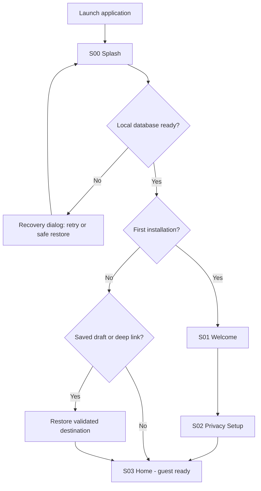
### 02 full route map


### 03 feature entry points

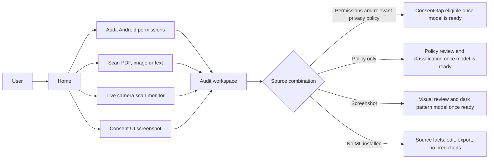
### 04 android permission inspector

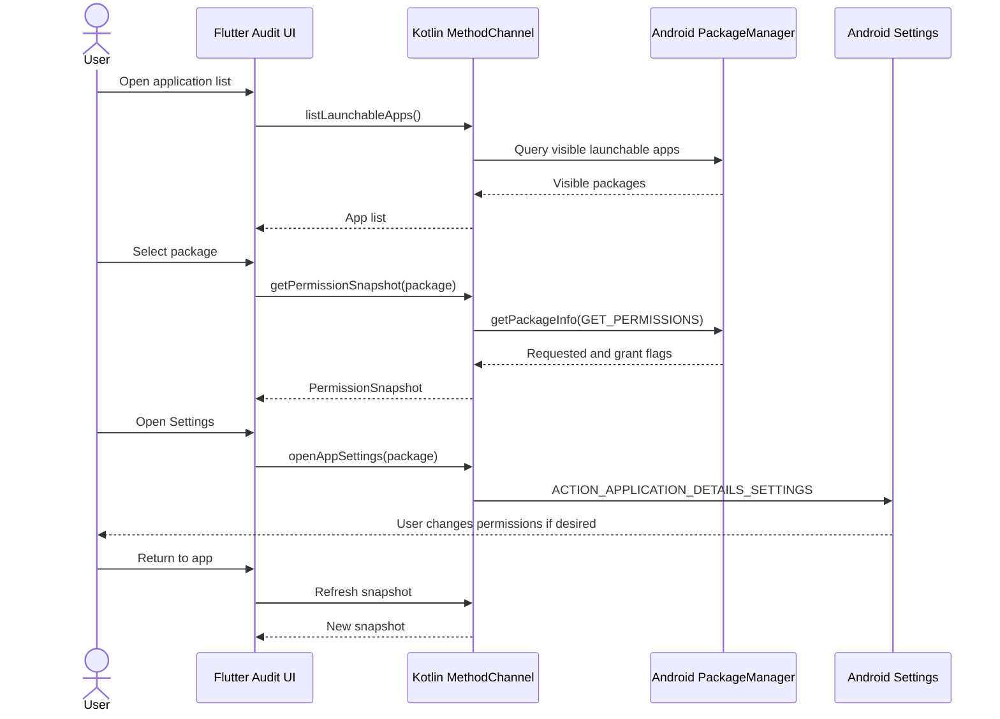
### 05 import and ocr

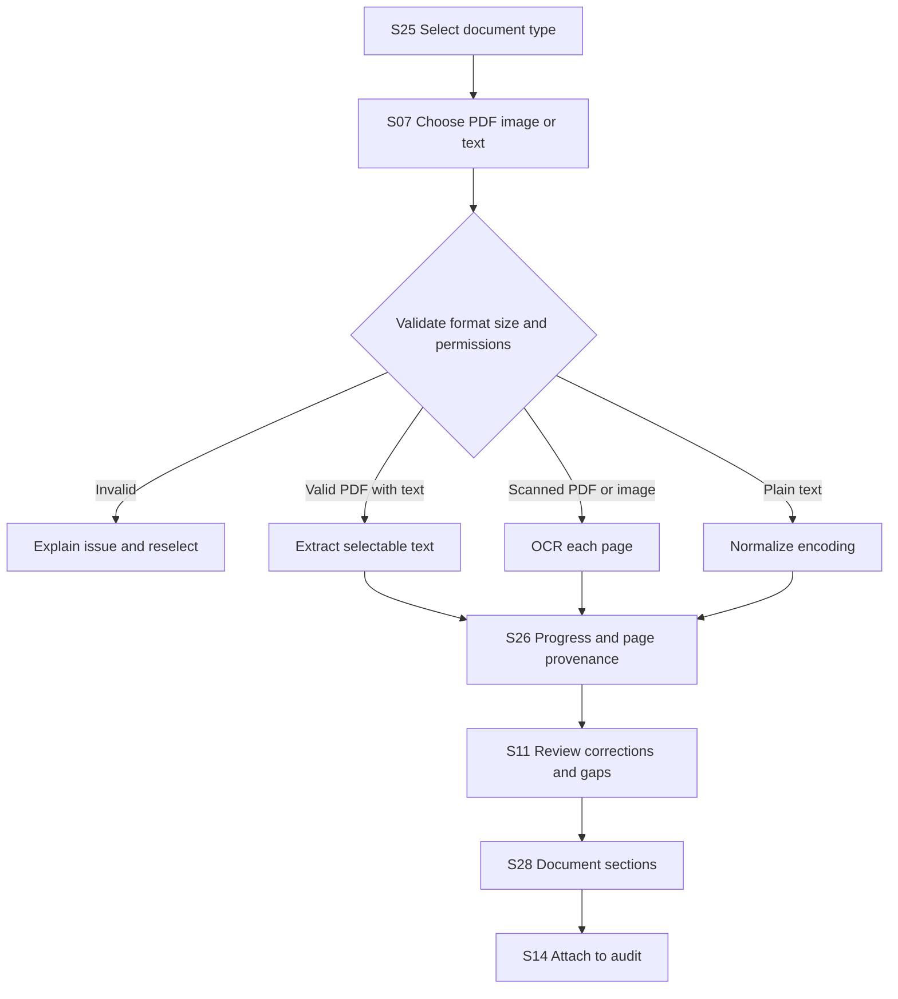
### 06 livescan camera sequence

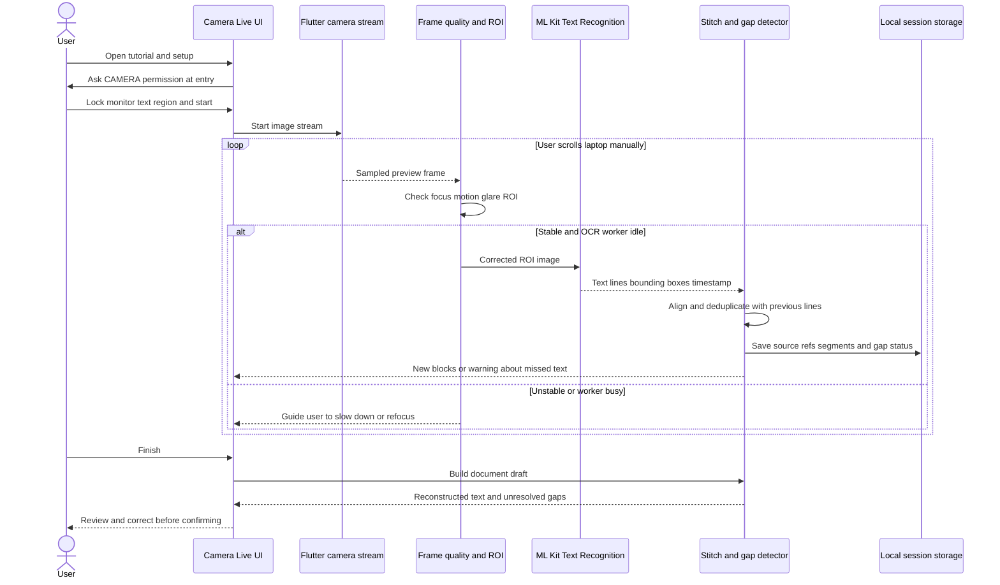
### 07 livescan state machine

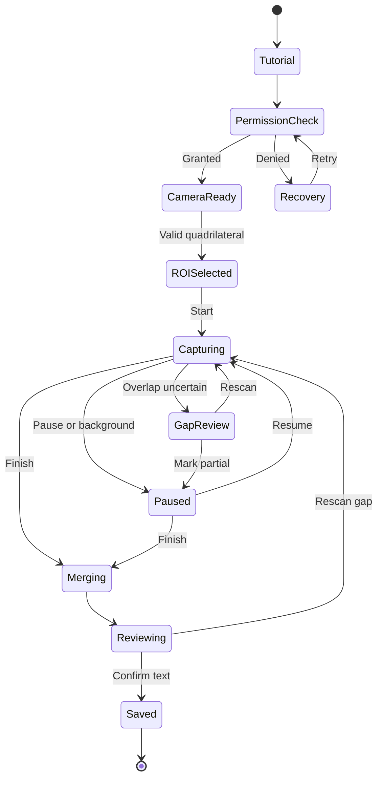
### 08 consent ui and dark pattern

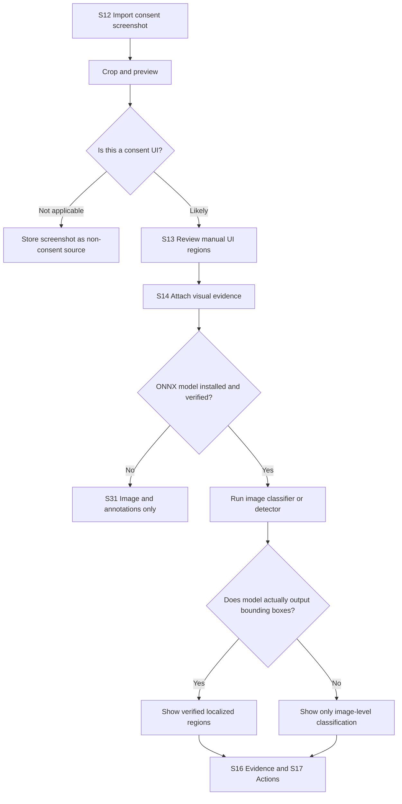
### 09 analysis engine gates

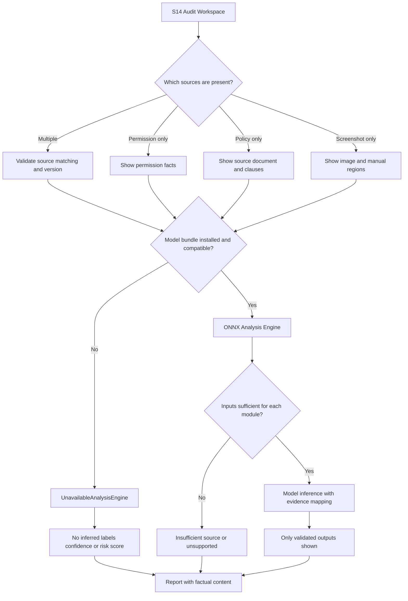
### 10 consentgap comparison

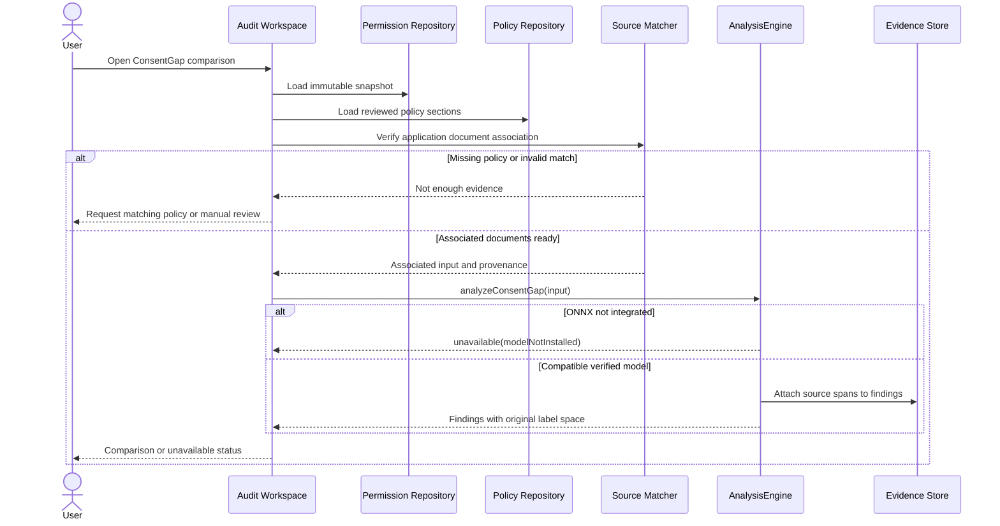
### 11 evidence actions report

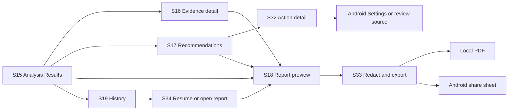
### 12 auth sync privacy

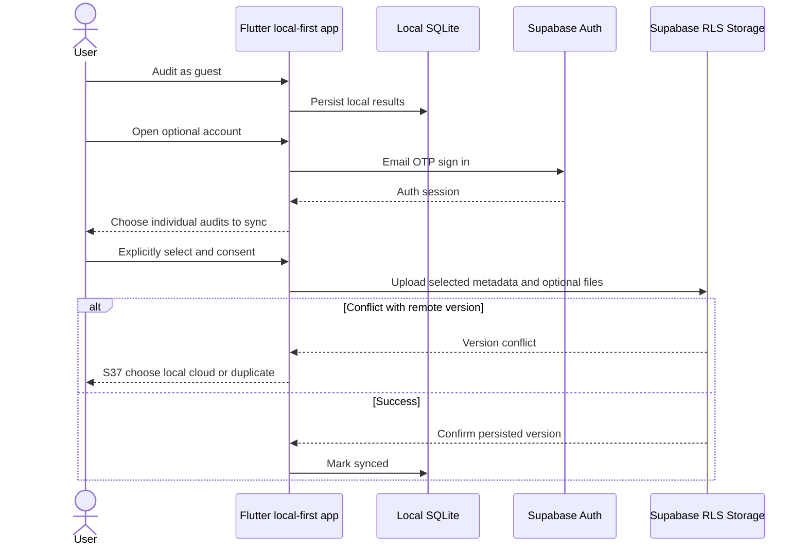
### 13 error recovery

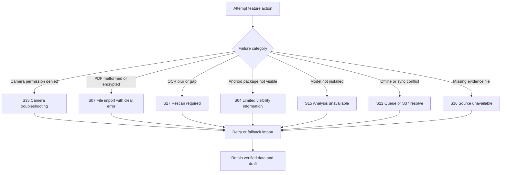
### 14 page state machine

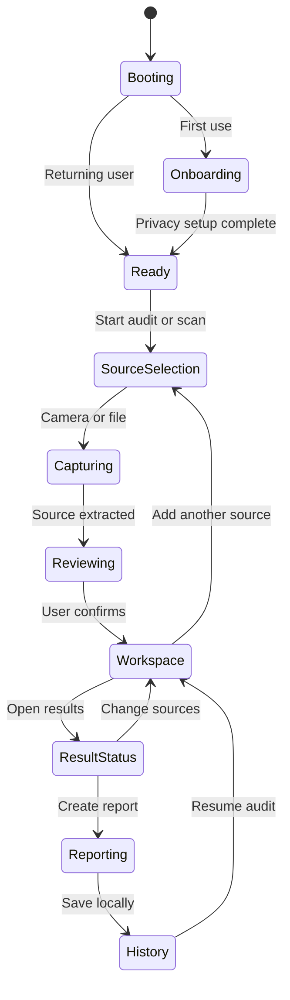
### 15 implementation phase gates

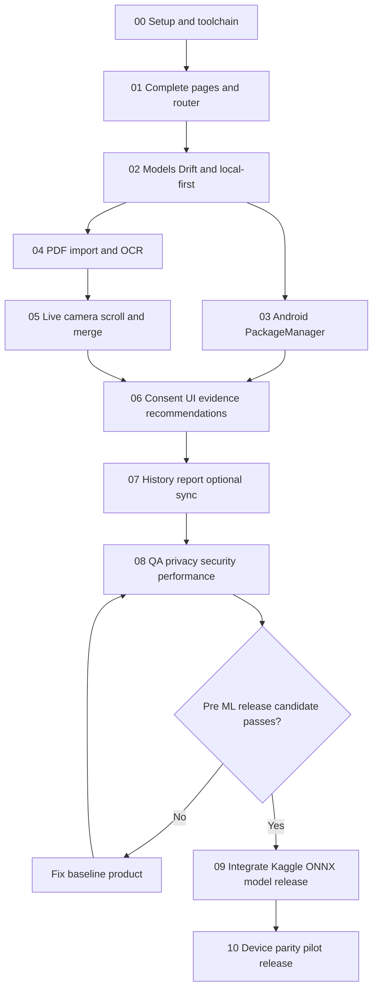
### 16 document data model

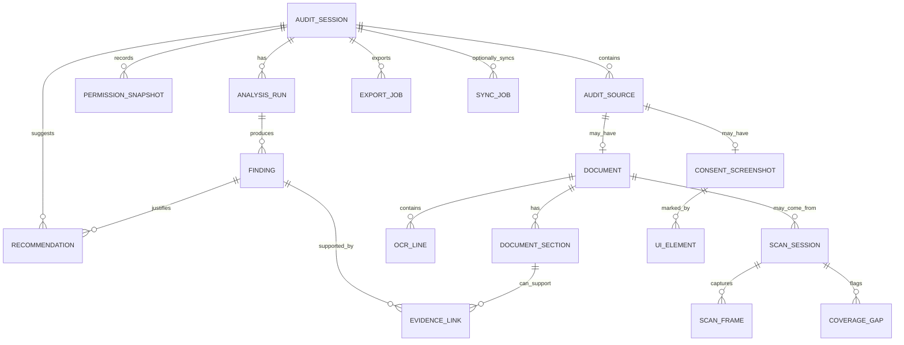
## K. Konvensi folder Flutter untuk page-to-page

```text
lib/
  app/
    bootstrap/  router/  theme/  dependency_injection/
  core/
    errors/  result/  privacy/  persistence/  permissions/  widgets/
  features/
    onboarding/presentation/pages/       # S01-S02
    home/presentation/pages/             # S03
    permission_inspector/presentation/   # S04-S05
    scan_hub/presentation/               # S06 S25
    policy_scanner/presentation/         # S07 S11 S26 S28
    live_camera/presentation/            # S08-S10 S27 S35 S39
    consent_ui/presentation/             # S12 S13
    audit_workspace/presentation/        # S14 S24 S38
    analysis/presentation/               # S15 S29 S30 S31
    evidence/presentation/               # S16
    actions/presentation/                # S17 S32
    reports/presentation/                # S18 S33
    history/presentation/                # S19 S34
    settings/presentation/               # S20 S23 S36
    account/presentation/                # S21
    sync/presentation/                   # S22 S37
  main.dart                                # S00 splash integrated boot
```

Setiap feature wajib memiliki `presentation`, `domain`, `data` (dan `bloc`/`cubit` di presentation). Route names jangan diganti setelah golden tests ditulis. Semua layar punya test untuk rendering loading/success/empty/error, semua CTA harus memiliki aksi, dan page navigator tidak boleh mengimpor Kotlin/SQL langsung.

## L. Tahapan pekerjaan Claude Code dengan entry/exit gates

| Fase | Deliverables page-by-page | Wajib lulus sebelum lanjut |
|---|---|---|
| 00 Setup | repo, Flutter Android, router stub, CI, README | `flutter pub get`, `flutter analyze`, `flutter test`, build debug jika SDK ada |
| 01 Complete UI | **Semua S00–S39** sebagai screens navigable, design system, real UI state, placeholder yang jujur | routing test, goldens, tidak ada tombol mati tanpa alasan |
| 02 Local data | Drift/SQLite, audit session, source, draft, history, resume | persist/restart/migrations/unit test |
| 03 Android native | S04/S05 + bridge Kotlin `PackageManager` | uji Android fisik, Settings dan refresh |
| 04 File/OCR | S07/S11/S25/S26/S28 + PDF text/OCR | file corrupt, scanned, Indonesia/English, pagination |
| 05 Live Camera | S08–S10/S27/S35/S39 + OpenCV/MLKit/stitch | pemindaian monitor nyata, gap detection, no leaks |
| 06 Consent/evidence | S12–S17, S29/S31/S32/S38 dan rekomendasi rule-based | bukti sumber benar, no fake ML |
| 07 Report/cloud | S18–S23, S33–S37; PDF + opt-in Supabase | RLS antar-user, sync conflict, local delete |
| 08 Stabilize | accessibility, performance, security, failures, device matrix | release candidate tanpa ONNX berjalan utuh |
| **09 ONNX last** | onnxruntime Android, tokenizer, thresholds, verified model manifest, real inference | parity Kaggle/ORT, tensor shape, label mapping, memory/latency |
| 10 Release | pilot, final QA, APK/AAB, model card | verified evidence and privacy disclosures |

### Aturan Claude Code yang tidak boleh dilewati

1. Buka dan baca PRD induk serta dokumen ini sebelum menulis kode.
2. Gunakan navigasi S00–S39 sebagai **kontrak route**, bukan gambar statis. Implementasi per fase boleh memakai state belum tersedia, tetapi setelah fase UI seluruh layar harus benar-benar dapat dinavigasi.
3. Jangan membuat service AI tiruan dengan random confidence atau laporan risiko palsu. Data demo hanya dalam build `demo`, dengan tanda terlihat.
4. Jangan membuat `QUERY_ALL_PACKAGES`, `AccessibilityService`, MediaProjection, dan izin storage luas tanpa kebutuhan dan review kebijakan platform. LiveScan kamera memakai izin CAMERA pada konteks yang jelas.
5. Seluruh hasil OCR direview dan dapat dikoreksi; tidak ada klaim 100% dokumen dipindai jika panjang total tidak diketahui.
6. Setiap fase menghasilkan `CHANGELOG_PHASE_NN.md`, `TEST_REPORT_PHASE_NN.md`, `KNOWN_ISSUES.md`, dan screenshot/golden jika tersedia.
7. Jika environment tidak punya Flutter/Android SDK atau perangkat, tandai pengujian **NOT RUN** dengan alasan dan langkah menjalankannya. Jangan pernah mengklaim pengujian lulus tanpa hasil nyata.

## M. Definition of Done lintas produk

- Seluruh route S00–S39 aktif, punya CTA nyata, back navigation benar, dan tidak ada orphan screen.
- Pengguna bisa masuk sebagai tamu dari splash, menjalankan audit izin, PDF OCR, LiveScan laptop, dan screenshot consent.
- Audit menyimpan sumber lokal, menunjukkan risiko ketidakcukupan sumber dengan benar, bukti tidak terlepas dari asalnya.
- Pengguna dapat melihat, koreksi, simpan, ekspor PDF, share, hapus, dan melanjutkan audit dari riwayat; cloud benar-benar opsional.
- Ketika ONNX belum ada, hanya kemampuan model yang unavailable. Produk tidak macet dan tidak memalsukan hasil AI.
- Setelah ONNX, hasil model dapat diuji dan diikat pada `modelVersion`, `sourceVersion`, `evidence`, `thresholds`, dan `evaluation metadata`.
- Uji Android nyata, keberhasilan ekspor PDF, kegagalan permission kamera, recovery gap OCR, RLS cloud, dan performa dijalankan sebelum rilis.

## N. Referensi baseline proyek

- `PRD_KONSENA_AI_MOBILE.md` (dokumen induk)
- `DESIGN_SYSTEM.md` (identitas UI)
- `IMPLEMENTATION_PHASES.md` (dependency dan gates)
- `CONTRACTS_AND_EVENTS.md`, `contracts/*.json` (payload lintas layer)
- `database/supabase_schema.sql` (cloud opt-in)

**Catatan:** dokumen ini tidak menggantikan pengujian di perangkat fisik. Semua klaim akurasi model harus berasal dari eksperimen Kaggle yang tervalidasi, bukan PRD.


## Apendiks — Warna UI v2 (berlaku untuk S00–S39)

- Splash/Header: Midnight Purple `#252148`, teks Cloud White `#FDFCFE`.
- Halaman umum: Cloud White `#FDFCFE`; area utama/hero: Pale Lavender `#EFE6FB`.
- CTA: Royal Violet `#5A3DAD` dengan teks putih; state pressed Deep Indigo `#342D61`.
- Aktif/scan reticle: Electric Violet `#7838D8`; navigasi terpilih Soft Lilac `#E5E0F9`.
- Card: putih, border dekoratif Lavender `#C4BDD6`, border fokus tegas `#8F83A8`.
- Status: hijau `#36C77B`, amber `#FFB83F`, merah `#EF6464`; teks di atasnya Midnight Purple.
- Tidak boleh menggunakan hijau/teal sebagai identitas brand lagi.

Referensi implementasi: `DESIGN_SYSTEM_v2.md`, `KONSENA_THEME.dart`, `color_tokens.json`.


## O. Overlay referensi Stitch v3 — hanya layar yang tersedia

| Page | Sumber | Visual contract | Functional contract |
|---|---|---|---|
| S00 Splash | `references/stitch/s00_splash_screen/code.html` | gelap radial, glow violet, logo PNG transparan, headline/tagline | bootstrap/migrasi lokal tanpa minta kamera |
| S01 Onboarding | `references/stitch/s01_onboarding/code.html` | headline besar, tombol `Lewati`, CTA violet, safe area | 3 slide + skip, lanjut S02, tanpa akun wajib |
| S03 Dashboard | `references/stitch/01_dashboard/screen.png` | header, hero, 2 summary cards, 3 langkah, bottom nav 5 | ringkasan query SQLite, CTA S24, badge DEMO hanya pada demo flavor |

**Layar S02 dan S04–S39 tidak memiliki mockup di ZIP.** Turunkan dari `DESIGN_SYSTEM.md` dan spesifikasi di atas. Pada screen S21 (tab Profil) sediakan mode guest secara lengkap tanpa login. `Audit Baru` pada nav membuka S24 sedangkan S04 adalah child, sehingga tidak mengubah fungsi PackageManager yang tetap ada pada fase 03.

### Route consistency / anti-dead-end checks

- Five tabs: `/home` (S03), `/audit/new` (S24), `/scan` (S06), `/history` (S19), `/profile` (S21).
- `/account` adalah alias dari `/profile`, bukan layar keenam; `settings`, `sync`, `about` tetap nested child.
- CTA `Mulai Audit` di S03 -> S24 -> S04 atau S14. CTA `Pindai` -> S06 -> S07/S08/S12. S19 -> S34 -> S18; S21 -> S20/S36/S23/S22 jika opt-in.
- Setiap bottom-tab switch wajib preserve current draft; tombol kembali dari child route harus kembali ke tab asal dan tidak mengganti audit aktif.
- Selama engine `UnavailableAnalysisEngine`, S29/S30/S31 harus menampilkan ketidaksediaan dengan opsi meninjau sumber, bukan temuan simulasi.

**Implementasi Phase 01B:** indeks §D dipetakan 1:1 di
`lib/app/navigation/route_registry.dart` dan diverifikasi oleh
`test/navigation/route_registry_test.dart` + `navigation_test.dart`. Route ID
dan canonical path tidak berubah; `/account` tetap redirect alias, bukan Screen
ID. Stateful tab shell berada di `lib/app/navigation/konsena_tab_shell.dart`.

Dokumen eksekusi: `CLAUDE.md` sebagai aturan permanen, `prompts/PHASE_00_REPO_SUPABASE.md` sebagai **prompt eksekusi pertama**, dan satu file prompt terpisah per phase lainnya di `prompts/README.md`. Tidak ada master prompt. Phase 00 menyiapkan Supabase; Phase 07 mengaktifkan sinkronisasi opt-in. Jangan menjalankan semua fase dalam satu sesi.
