# PRODUCT REQUIREMENTS DOCUMENT (PRD)
# KONSENA AI — Asisten Cerdas Analisis Persetujuan dan Perlindungan Privasi Digital

**Tagline:** Pahami Persetujuan, Lindungi Data Pribadi.  
**Dokumen:** Product Requirements Document, arsitektur, kontrak implementasi, dan panduan fase Claude Code
**Revisi:** v3.0, 7 November 2026. Basis v2 dipertahankan; diselaraskan dengan ZIP referensi Stitch (S00, S01, S03).  
**Versi:** 1.0 | **Tanggal:** 7 November 2026 | **Status:** Baseline rancangan, belum implementasi  
**Platform:** Android-first (Flutter + Kotlin) | **Bahasa:** Indonesia (utama), Inggris (dokumen sumber)  
**Pola pengembangan:** Setup → UI/UX → implementasi fitur nyata → hardening → **integrasi ONNX paling akhir**

> **Aturan terpenting:** seluruh alur aplikasi yang tidak membutuhkan model ML harus selesai secara nyata sebelum ONNX ditanamkan. Tidak boleh mengarang skor, label pelanggaran, confidence, atau temuan ML pada data asli. Pada fase pra-ONNX, tampilkan `belum dianalisis` dengan alasan dan CTA yang jelas. Mode demo memakai data simulasi yang diberi label **DEMO** pada semua layar.

---

## 0. Ringkasan eksekutif

KONSENA AI adalah aplikasi Android untuk membantu individu menilai persetujuan dan praktik privasi digital berdasarkan bukti yang dapat ditinjau pengguna. Pengguna dapat: (1) memeriksa informasi izin aplikasi Android yang dapat dilihat sistem; (2) mengimpor PDF/teks/gambar kebijakan privasi; (3) menggunakan kamera ponsel untuk memindai dokumen panjang pada monitor/laptop sambil scroll secara manual; (4) menganalisis screenshot dialog persetujuan untuk indikasi dark pattern; (5) membandingkan tujuan izin dengan klausul kebijakan; dan (6) membaca rekomendasi tindakan serta bukti pendukung. Analisis berbasis ML aktif **hanya** sesudah model ONNX, preprocessing, label mapping, dan uji kesetaraannya tersedia.

### 0.1 Tujuan terukur

| Kode | Hasil produk | Indikator penerimaan |
|---|---|---|
| G-01 | Pengguna dapat memulai tanpa akun | Audit dan LiveScan lokal berjalan dalam mode tamu |
| G-02 | Alur permission inspector fungsional | Daftar aplikasi yang terlihat, daftar izin, status izin, dan tautan Settings bekerja di perangkat nyata |
| G-03 | Dokumen panjang bisa dibaca kamera | Rekonstruksi teks dengan deteksi overlap dan status gap; pengguna dapat koreksi |
| G-04 | Dokumen siap dianalisis secara bertanggung jawab | Segmen, sumber, area/posisi, status verifikasi OCR tercatat |
| G-05 | Pengguna mengetahui batas analisis | Label not-available/uncertain bila sumber atau model tidak tersedia |
| G-06 | Pengguna punya kontrol data | Export/delete lokal, opt-in sinkronisasi, otorisasi akses per pengguna |
| G-07 | Integrasi ONNX tidak merusak produk | Model mengikuti kontrak engine; hasil ONNX melewati parity test dan golden test |

**Non-goal untuk versi pertama:** membuka seluruh riwayat penggunaan izin aplikasi lain, mengubah izin aplikasi lain secara otomatis, menyadap aktivitas latar belakang, mendeteksi data yang dikirim ke server pengembang aplikasi, membuktikan pelanggaran UU PDP, melakukan legal advice, dan memantau seluruh aplikasi tanpa persetujuan pengguna.

### 0.2 Definisi istilah

- **Privacy Policy:** penjelasan pengolahan data pribadi. **Terms of Service** mengatur penggunaan layanan; tidak selalu mencakup seluruh praktik privasi. KONSENA AI harus membedakan `document_type` keduanya.
- **Permission declared:** izin dideklarasikan pada manifest aplikasi; **permission granted:** status pemberian yang bisa dibaca oleh Android. Bukan bukti bahwa izin digunakan atau data dikirim.
- **ConsentGap:** perbandingan antara permintaan izin/tindakan pengumpulan data yang teramati dengan klausul yang ditemukan di dokumen; `not_found` bukan otomatis `contradicted`.
- **OCR coverage:** cakupan *bagian yang berhasil ditangkap*, bukan persentase panjang total dokumen bila panjang total tidak diketahui.
- **Confidence:** hanya skor terkalibrasi dari komponen yang memang menghasilkan confidence; tidak boleh dihitung sembarang.
- **Evidence:** kutipan, koordinat halaman/teks/frame, hash dokumen, timestamp, metode ekstraksi, dan jejak transformasi.

---

## 1. Persona, kebutuhan, dan skenario penggunaan

### 1.1 Persona

1. **Pengguna umum Android:** ingin memahami izin aplikasi sebelum menyetujui; tak memahami istilah teknis.
2. **Mahasiswa/pencari kerja:** membuka ToS panjang pada laptop dan ingin memeriksanya menggunakan kamera ponsel.
3. **Pengguna yang peduli privasi:** ingin melihat dasar temuan, merapikan pengaturan dan menyimpan riwayat audit.
4. **Peneliti/evaluator (internal):** membutuhkan mode demo terisolasi, log evaluasi dan data uji berizin; tidak boleh mengakses dokumen pengguna lain.

### 1.2 Jobs-to-be-done

- “Ketika aplikasi meminta kontak/lokasi, saya ingin tahu apakah penggunaan data itu dijelaskan dan bagaimana mengubah izinnya.”
- “Ketika ToS tampil panjang di laptop, saya ingin memindainya sambil scroll, lalu mengoreksi teks yang terlewat.”
- “Ketika dialog persetujuan tampak memaksa, saya ingin melihat bukti yang membuatnya dicurigai, bukan hanya label ‘berbahaya’.”
- “Ketika tidak ada internet, saya tetap ingin memindai kamera, membaca izin, meninjau hasil OCR, dan menyimpan laporan lokal.”

### 1.3 User journey utama

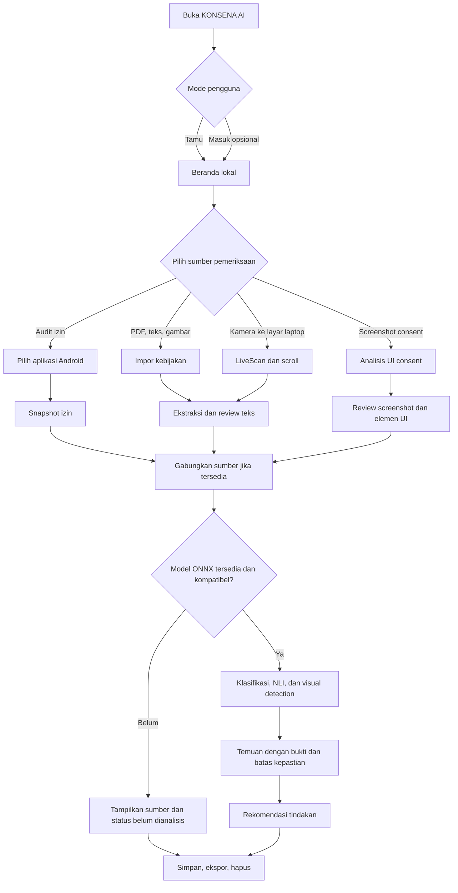

---

## 2. Lingkup produk, fase, dan prioritas

**P0 = harus selesai sebelum rilis internal; P1 = penting tetapi tidak menghalangi MVP; P2 = lanjutan.** Semua modul ditampilkan secara konsisten di navigasi; status kemampuan yang belum tersedia tidak boleh diwakili keluaran fiktif.

| ID | Modul | Prioritas | Implementasi sebelum ONNX | Setelah ONNX |
|---|---|---|---|---|
| F01 | Onboarding, izin dan consent | P0 | Nyata | Tetap |
| F02 | Beranda dan pusat fitur | P0 | Nyata | Tampilkan ringkasan model nyata |
| F03 | Android Permission Inspector | P0 | Nyata | Menyediakan fakta untuk ConsentGap |
| F04 | Policy Scanner PDF/teks/gambar | P0 | Ekstraksi, review, segmen, sumber | Klasifikasi klausul |
| F05 | Live Camera Document Scanner | P0 | Kamera/OCR/scroll/merge/review | Klasifikasi hasil pemindaian |
| F06 | Consent UI screenshot collector | P0 | Impor, anotasi, koreksi tampilan | Dark Pattern Detector |
| F07 | ConsentGap AI | P0 | Kontrak UI, join data, status pending | NLI 5 kelas hanya bila data/label mendukung |
| F08 | Privacy Risk Analysis | P1 | Aturan transparan/non-prediktif bila terbukti | Kalkulasi tervalidasi, tidak menyimpulkan ilegalitas |
| F09 | Evidence Explorer | P0 | Sumber dan highlight OCR asli | Bukti terkait temuan ONNX |
| F10 | Recommendation Center | P0 | Saran berbasis izin nyata dan aturan eksplisit | Saran berdasarkan temuan model |
| F11 | Riwayat, laporan, ekspor, hapus | P0 | Nyata | Laporan ML diperluas |
| F12 | Login dan cloud sync opt-in | P1 | Nyata setelah local-only stabil | Tetap |
| F13 | Aksesibilitas, keamanan, observability | P0 | Nyata | Tetap |
| F14 | Offline on-device ONNX integration | **Fase terakhir** | Hanya interface/no-op provider | Model riil terverifikasi |

### 2.1 MVP tidak sama dengan dataset training

- Dataset APP-350, OPP-115, IndoNLI, ContextRico-DP dan AppRay adalah sumber **training/evaluasi terpisah**, bukan isi aplikasi produksi.
- Pengguna aplikasi tidak wajib melihat nama dataset. Yang relevan adalah versi model, label, dasar bukti, dan kemampuan yang memang tersedia.
- Untuk LiveScan gunakan ML Kit OCR yang sudah tersedia; tidak perlu menunggu notebook training ONNX.

---

## 3. Stack, prinsip arsitektur, dan setup dari nol

### 3.1 Stack resmi

| Layer | Pilihan | Catatan |
|---|---|---|
| Mobile framework | Flutter stable + Dart | Android-only untuk versi 1; jangan bangun iOS dalam fase ini |
| Android native | Kotlin, `MethodChannel` / `EventChannel` | `PackageManager`, `Settings` Intent, kamera native jika diperlukan |
| State | `flutter_bloc` / Cubit | Satu feature module, satu controller; immutable state |
| Routing | `go_router` | Typed route names, guarded routes, nested shell bottom nav |
| Dependency injection | `get_it` atau constructor injection | Interface repository, bukan pemanggilan service langsung dari widget |
| Models | `freezed`, `json_serializable` | DTO domain berbeda dari DTO transport dan database |
| Local | Drift / SQLite | Snapshot audit, indeks, progress scan; bersihkan file sementara |
| Secure secrets | Android Keystore via plugin secure storage | Token dan kunci; jangan simpan service-role key |
| Cloud sync opt-in | Supabase Auth, Postgres, Storage RLS **di-setup sejak Phase 00** | Guest-first; login/sync opt-in; private bucket |
| Camera | plugin `camera` yang cocok SDK | Preview/stream, lifecycle, permission |
| OCR | ML Kit Text Recognition v2 Latin | Bundled diprioritaskan agar offline langsung tersedia |
| Vision utilities | OpenCV (native bila perlu) | Crop, perspective correction, focus/blur metrics, registration |
| Import | Android SAF/file picker, MIME checking | PDF, JPEG/PNG, teks; size caps configurable |
| PDF extract | PDF text extraction library yang teruji | Prioritaskan teks asli, OCR hanya untuk halaman scan |
| Export | `pdf`, `printing`/Android share | Berkas ekspor dibangun lokal |
| ML terakhir | `onnxruntime-android` Kotlin | Flutter adapter; tokenizers & label mapping versi model |
| Optional API | FastAPI untuk kebutuhan non-core, bukan keharusan inferensi | Jangan wajibkan server untuk permission dan LiveScan |

**Kebijakan kompatibilitas (per 7 November 2026):** minimum Android API 24 sebagai baseline produk; `targetSdk` minimal API 36 agar selaras persyaratan rilis Google Play tahun 2026. Gunakan `compileSdk` kompatibel dengan SDK terbaru dan toolchain terpasang; jangan menebak versi AGP/Kotlin/Gradle jika belum dicek. Simpan versi aktual di `pubspec.lock` serta lock dependencies Android.

Sumber teknis: [Google Play API requirements](https://support.google.com/googleplay/android-developer/answer/11926878), [Flutter camera](https://pub.dev/packages/camera), [ML Kit OCR](https://developers.google.com/ml-kit/vision/text-recognition/v2/android), [Android package visibility](https://developer.android.com/training/package-visibility).

### 3.2 Setup fase 0 — wajib langkah pertama

**Prasyarat mesin pengembang:** Flutter stable + Android SDK platform/API 36 + platform-tools, JDK yang kompatibel dengan template Flutter/AGP, IDE, Git; emulator dan minimal satu perangkat Android fisik untuk kamera/permission. Firebase tidak wajib.

```bash
flutter --version
flutter doctor -v
adb devices
flutter create --org id.konsena --platforms=android konsena_ai
cd konsena_ai
git init
flutter pub add flutter_bloc go_router get_it freezed_annotation json_annotation
flutter pub add drift sqlite3_flutter_libs path_provider flutter_secure_storage
flutter pub add camera google_mlkit_text_recognition file_picker permission_handler
flutter pub add supabase_flutter pdf printing share_plus
flutter pub add dev:build_runner dev:freezed dev:json_serializable dev:drift_dev
flutter pub get
flutter analyze
flutter test
flutter run
```

> Paket dapat berubah sesuai kompatibilitas. Jika ada paket deprecated/unsupported, Claude Code harus memilih alternatif terpelihara, mencatat keputusan di ADR, dan melaporkan hasil `flutter pub get`. Jangan menganggap setup berhasil sebelum dijalankan. Jangan menambahkan ONNX dependencies saat fase 0.

**Contoh konfigurasi Android manifest minimum (disesuaikan package/entry):**

```xml
<uses-permission android:name="android.permission.CAMERA" />
<queries>
    <intent>
        <action android:name="android.intent.action.MAIN" />
        <category android:name="android.intent.category.LAUNCHER" />
    </intent>
</queries>
```

- Tidak meminta `QUERY_ALL_PACKAGES` secara default.
- Tidak menggunakan `AccessibilityService`, screen recording, overlay sistem, permission admin perangkat, atau izin storage luas untuk MVP.
- Rancang izin kamera **just-in-time** ketika pengguna masuk LiveScan, bukan saat pertama membuka aplikasi.
- Launcher query **tidak menjamin** semua aplikasi terlihat. Tampilkan keterbatasan secara eksplisit.
- Tambahkan konfigurasi Android Gradle/minSdk/targetSdk mengikuti template dan SDK yang diuji.

### 3.3 Variabel lingkungan

| Variable | Tempat | Perilaku jika kosong |
|---|---|---|
| `SUPABASE_URL` | `--dart-define` / flavor | Guest-only, sync disabled |
| `SUPABASE_PUBLISHABLE_KEY` (atau `SUPABASE_ANON_KEY` jika SDK lama) | client build (public, RLS wajib) | Guest-only |
| `ENABLE_CLOUD_SYNC` | flavor / remote config | Default false |
| `ENABLE_ML` | feature flag | Default false hingga ONNX valid |
| `ENABLE_DEMO` | debug/internal flavor | Default false release |
| `API_BASE_URL` | optional, jika backend dipakai | Jangan memblokir audit lokal |

Tidak boleh menaruh service-role key atau secret admin di aplikasi. Supabase anonymous/public key aman hanya jika grant dan RLS benar. Log build tidak boleh mencetak dokumen, token, atau data privasi.

### 3.4 Desain direktori

```text
konsena_ai/
├── android/app/src/main/kotlin/id/konsena/ai/
│   ├── MainActivity.kt
│   ├── PermissionInspectorPlugin.kt
│   └── OnnxBridge.kt                 # hanya dibuat fase final
├── lib/
│   ├── app/                        # app, routing, dependency graph, theme
│   ├── core/                       # errors, result, secure prefs, utils, config
│   ├── design_system/              # tokens, widgets, states
│   ├── features/
│   │   ├── onboarding/
│   │   ├── home/
│   │   ├── permissions/
│   │   ├── policy_import/
│   │   ├── livescan/
│   │   ├── consent_ui/
│   │   ├── analysis/
│   │   ├── evidence/
│   │   ├── recommendations/
│   │   ├── history/
│   │   ├── reports/
│   │   └── settings/
│   └── main.dart
├── test/; integration_test/; test/fixtures/
├── assets/demo/                     # jelas DEMO, tidak dipakai produksi
├── supabase/migrations/
├── contracts/; docs/adr/
├── scripts/verify.sh
├── .env.example
└── README.md
```

Setiap `features/<name>/` dipisah menjadi `presentation/`, `domain/`, `data/`; UI **tidak boleh** mengakses database/MethodChannel langsung. Dependency injection memungkinkan provider `UnavailableAnalysisEngine` diganti `OnnxAnalysisEngine` pada fase terakhir.

---

## 4. Arsitektur komponen dan integrasi

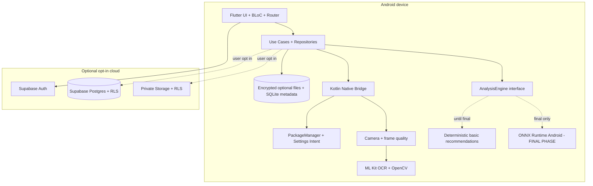

**Data flow prinsip:** Kamera menghasilkan OCR lokal; frame mentah hanya dalam memori sementara kecuali pengguna memilih menyimpan bukti. Snapshot izin dan hasil OCR menjadi `AuditSource`. Analyzer menerima dokumen bersegmen dan snapshot izin terpisah. Evidence ID harus menunjuk sumber sesungguhnya. Sinkronisasi cloud tidak otomatis mengunggah gambar/document mentah.

### 4.1 Antarmuka engine versi stabil (paling penting untuk ONNX nanti)

```dart
abstract interface class AnalysisEngine {
  Future<EngineCapabilities> capabilities();
  Future<PolicyAnalysisResult> classifyPolicy(PolicyAnalysisInput input);
  Future<ConsentGapResult> analyzeConsentGap(ConsentGapInput input);
  Future<DarkPatternResult> detectDarkPatterns(ConsentUiInput input);
}
```

Pada fase 1–7 gunakan `UnavailableAnalysisEngine`: mengembalikan `AnalysisUnavailable(reason: modelNotInstalled)` dan **tidak** membuat label AI. Rekomendasi berbasis aturan diimplementasi terpisah dan diberi tag `source=rule_based`. Pada fase akhir, provider diganti tanpa mengganti UI dan model domain.

### 4.2 Alur status analisis

`not_started → waiting_for_source → ready → running → completed | partial | failed | unavailable`. UI harus menampilkan sumber yang dipakai, versi model (jika ada), dan peringatan bila hasil parsial.

---

## 5. Struktur navigasi, route, dan halaman

### 5.1 Bottom navigation — revisi mengikuti referensi Stitch

Bottom navigation **lima tujuan** (konsisten dengan `01_dashboard/screen.png`):

| Posisi | Label UI (Bahasa Indonesia) | Route | Halaman | Perilaku |
|---|---|---|---|---|
| 1 | Beranda | `/home` | S03 | Ringkasan dan CTA mulai audit |
| 2 | Audit Baru | `/audit/new` | S24 | Membuat atau melanjutkan sesi audit; S04 menjadi child |
| 3 (tengah) | Pindai | `/scan` | S06 | Aksi utama visual; pilihan sumber PDF/teks/kamera/screenshot |
| 4 | Riwayat | `/history` | S19 | Sesi tersimpan, filter, ekspor, hapus |
| 5 | Profil | `/profile` | S21 | Profil tamu, kontrol privasi, akun/sync opsional |

Navigasi bekerja pada **mode tamu tanpa login**. S21 bukan gerbang autentikasi. `/account` diterima sebagai alias lama yang mengarah ke `/profile` (tanpa duplikasi layar). Semua tab mempertahankan state saat berpindah; detail route tetap child. `Pengaturan` dapat diakses dari Profil dan ikon header yang relevan. Di bawah 360dp, label ringkas dan ikon tetap jelas; semua target sentuh minimal 48dp.

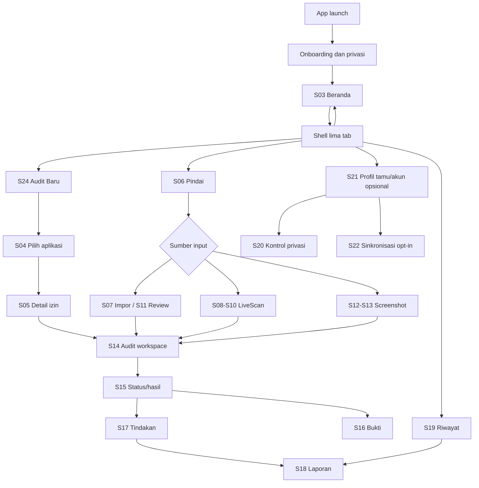

### 5.2 Inventaris layar (ID, route, elemen, state)

| ID | Route | Konten utama | CTA | Empty/error |
|---|---|---|---|---|
| S00 | `/splash` | cek migrasi DB dan preferensi | otomatis | recovery DB |
| S01 | `/welcome` | value proposition + offline-first | Mulai | tidak butuh login |
| S02 | `/privacy-setup` | izin kamera saat diperlukan, info data | Setuju & lanjut | skip kamera |
| S03 | `/home` | 4 kartu fitur, aktivitas terakhir | Mulai audit/scan | no history |
| S04 | `/audit/apps` | search daftar launcher-visible | Pilih aplikasi | visibilitas terbatas |
| S05 | `/audit/apps/:package` | detail izin, deklarasi/status/waktu snapshot | Buka Settings, tambah dokumen | paket hilang |
| S06 | `/scan` | pilih LiveScan, PDF, teks, screenshot | pilih mode | permission denied |
| S07 | `/scan/import` | file-picker, tipe, ukuran, sumber | Ekstrak | format unsupported |
| S08 | `/scan/camera/setup` | viewfinder, crop quadrilateral, brightness | Kunci area, Mulai | kamera gagal |
| S09 | `/scan/camera/live` | frame OCR, status stabilitas, gap, stats | Pause/Selesai | OCR unready |
| S10 | `/scan/camera/merge` | blok berurutan, duplicate/gap | Lanjut review | overlap lemah |
| S11 | `/scan/review/:docId` | text editor, highlight uncertainty, sources | Konfirmasi teks | teks kosong |
| S12 | `/consent-ui/import` | image picker + crop | Tinjau screenshot | no image |
| S13 | `/consent-ui/review` | highlight UI region manual/pra-ML | Simpan sumber | no ML output |
| S14 | `/audit/:id/sources` | gabungkan apps/docs/screens | Analisis saat tersedia | incomplete source |
| S15 | `/audit/:id/results` | cards hasil/status model | Bukti, tindakan | model unavailable |
| S16 | `/audit/:id/evidence/:evidenceId` | kutipan, frame, provenance | Kembali ke hasil | hilang sumber |
| S17 | `/audit/:id/actions` | rekomendasi berprioritas | Buka Settings | tidak ada isu |
| S18 | `/audit/:id/report` | ringkasan export | PDF/share | gagal export |
| S19 | `/history` | list hasil lokal, filter, delete | Buka laporan | kosong |
| S20 | `/settings` | bahasa, data, aksesibilitas, privasi | ekspor/hapus | offline |
| S21 | `/profile` | profil tamu, ringkasan penyimpanan lokal; login/logout opsional | kontrol data, sync opt-in | tanpa akun tetap dapat menggunakan aplikasi |
| S22 | `/sync` | opt-in upload selection, status retry | upload sekarang | conflict/offline |
| S23 | `/about` | scope, model version, terms, privacy | dokumen | tautan rusak |

Setiap layar wajib: skeleton/loading, empty, denied, offline (bila relevan), retry dan desain responsif 360dp–tablet. Tombol `back` menjaga state draft bila belum disimpan.

---

## 6. Design system dan standar UX

**Rujukan visual implementasi v3:** `references/stitch/01_dashboard/screen.png`, `references/stitch/s00_splash_screen/code.html`, `references/stitch/s01_onboarding/code.html`, dan `docs/DESIGN_REFERENCE_MAPPING.md`. Screenshot adalah referensi **komposisi**, bukan bukti UI Flutter sudah diimplementasikan. Jangan menyalin HTML/Tailwind menjadi kode aplikasi. Untuk konflik, palet identitas yang disetujui pada `docs/DESIGN_SYSTEM.md` mengungguli warna contoh sumber Stitch; elemen layout, copy, hierarki, komponen, dan urutan navigasi menggunakan sumber Stitch bila tidak bertentangan dengan fungsi PRD.


### 6.1 Visual identity

- Brand: **KONSENA AI**, tagline tetap. Professional trust-tech, bukan visual alarmis.
- Light v2: primary Royal Violet `#5A3DAD`, pressed Deep Indigo `#342D61`, accent Electric Violet `#7838D8`, main background Pale Lavender `#EFE6FB`, page background Cloud White `#FDFCFE`, surface `#FFFFFF`, primary text Midnight Purple `#252148`, outline Lavender `#C4BDD6`; status success `#36C77B`, warning `#FFB83F`, danger `#EF6464`. Refer `DESIGN_SYSTEM.md` as single source of truth.
- Dark mode: kontras WCAG, tidak mengunci warna badge sebagai satu-satunya sinyal.
- Typography: system font/Inter substitute, body min 14sp, headline 20–28sp, scaling adaptif.
- Spacing scale: 4, 8, 12, 16, 24, 32; radius 10–20.
- UI bahasa Indonesia, istilah `Privacy Policy`, `Terms of Service`, `dark pattern` dipertahankan hanya saat perlu.

### 6.2 Komponen reusable

`KonsenaAppBar`, `PrivacyStatusChip`, `AuditSourceCard`, `PermissionTile`, `DocumentSectionCard`, `ScanQualityOverlay`, `ScanProgressSummary`, `GapWarningBanner`, `EvidenceQuoteCard`, `MLUnavailablePanel`, `RecommendationTile`, `PermissionLimitedInfo`, `ConfirmSensitiveActionSheet`, `EmptyState`, `ErrorState`, `EvidenceViewer`, `ExportOptionsSheet`.

### 6.3 Aturan presentasi yang tidak boleh dilanggar

- Skor risiko hanya tampil jika aturan penilaian versi tertentu telah divalidasi; jika belum, tampilkan “Belum ada penilaian risiko”.
- Warna merah **tidak otomatis** menandakan pelanggaran hukum.
- Tidak tampilkan progres “80% dari dokumen” pada LiveScan bila panjang dokumen tidak diketahui; tampilkan blok/paragraf valid, jeda, dan kesinambungan.
- Confidence OCR dan ML harus dibedakan, tidak dirata-rata tanpa dasar.
- Riwayat izin adalah snapshot pada tanggal pemeriksaan, bukan log penggunaan sensor secara realtime.
- Hasil `not_found` harus berbunyi “belum ditemukan dalam sumber yang dianalisis”, bukan “tidak ada di kebijakan”.
- Item visual redaction secara default: pengguna bisa menyamarkan nama, email, nomor identitas sebelum cloud share.

---

## 7. Spesifikasi fitur rinci dan acceptance criteria

### F01 — Onboarding & kontrol privasi

**Fungsi:** jelaskan kegunaan dan keterbatasan, pilih guest atau login, set local-only default; izin kamera diajukan saat LiveScan; analytics crash logs nonkonten opt-in.  
**Masukan:** pilihan bahasa, opsi retensi, consent. **Keluaran:** preference dan session guest/user.  
**Edge cases:** pengguna menolak kamera: tetap bisa audit izin/unggah file; tidak ada internet: tetap masuk tanpa login.  
**Acceptance:** onboarding pertama kali maksimal 3 langkah, skip akun, persetujuan unggah cloud terpisah dari izin kamera.

### F02 — Beranda

**Visual v3 (above the fold):** header dengan simbol KONSENA kiri, `KONSENA AI` + label `PRIVACY INTELLIGENCE`, tanpa badge `DEMO` pada build biasa; hero bergradien indigo-violet dengan teks `Pahami izin. Lindungi privasi.`, subteks bukti, tombol `Mulai Audit`; ringkasan dari SQLite (nilai 0 ketika belum ada sesi, bukan data buatan); kartu `Bagaimana cara kerjanya?` berisi 3 langkah. Shortcut lama dapat ditempatkan setelah komposisi utama (di bawah fold) tanpa mengganggu screenshot reference. Bottom navigation lima tab.


**Fungsi:** shortcut Audit Izin, Policy Scanner, LiveScan, Dark Pattern Screenshot; daftar aktivitas terakhir; status kesiapan ML.  
**Acceptance:** tidak ada skor demo pada build production; kartu model belum tersedia mengarah ke informasi kemampuan, bukan halaman kosong.

### F03 — Android Permission Inspector

**Fungsi:** tampilkan subset aplikasi `LAUNCHER` yang terlihat; search; read `PackageInfo` dengan `GET_PERMISSIONS`; catat requested permission dan granted flag; kategorikan permission berdasarkan mapping transparan dan versi; buka halaman Settings aplikasi; re-scan setelah resume.  
**Inputs:** `packageName`; **outputs:** `AppSnapshot` dan `PermissionSnapshot[]`.  
**Status:** `declared_granted`, `declared_not_granted`, `non_runtime_or_unknown`, `unavailable`. Izin `normal` tidak boleh otomatis dianggap sensitif.  
**Batas:** tidak memonitor actual usage, jaringan, special app ops lintas OEM, seluruh installed packages, atau auto-revoke.  
**Edge:** aplikasi uninstalled, work-profile isolation, restricted visibility, permissions hilang, special permissions, caller tanpa launcher, Android versi berbeda.  
**Acceptance:** laporan UI cocok dengan status API yang tersedia pada uji Android 10, 12, 14, 16; refresh usai kembali Settings; 0 crash pada no-permission app.

**Android MethodChannel contract** (channel `id.konsena/permissions`, method dan payload stabil):

- `listVisibleLaunchableApps({includeSystem: false})` → `{apps: [{packageName,label,versionName,isSystem,iconRef?}], visibilityScope:"launcher_query"}`.
- `getPermissionSnapshot({packageName})` → `{capturedAt, androidSdk, packageName, versionName, requestedPermissions:[{name,protectionLevel?,granted?,statusCode,flags}]}`.
- `openAppSettings({packageName})` → `{opened:true|false, fallbackUsed?:boolean}`.
- Channel errors terstruktur: `PACKAGE_NOT_FOUND`, `NOT_VISIBLE`, `ACTIVITY_UNAVAILABLE`, `SDK_UNSUPPORTED`, `UNKNOWN`.

### F04 — Privacy Policy / Terms Scanner (import)

**Fungsi:** file picker SAF, paste text, import via Android Share intent (P1), PDF extract embedded text jika ada; OCR scanned PDFs/images; bahasa Indonesia/Inggris; segmen paragraf, heading, link sumber.  
**Inputs:** PDF/JPG/PNG/TXT/plain paste; max file/configurable (contoh default PDF 25MB, image 15MB, 100 halaman untuk MVP, ditandai batas produk, bukan batas library).  
**Outputs:** `Document`, `DocumentPage/Section`, `ExtractedSpan`, `OcrWarning`.  
**Important:** ToS dan Privacy Policy berbeda; algoritme tidak boleh menyimpulkan hak privasi dari ToS semata.  
**Acceptance:** PDF born-digital diproses tanpa OCR jika teks valid; encrypted PDF minta password atau unsupported; file rusak diberi error recoverable.

### F05 — KONSENA LiveScan (kamera ke laptop)

**Fungsi:** preview kamera → auto-detect area teks/monitor atau manual crop → perbaikan perspektif → stabilisasi → OCR frame sampling → kaitkan potongan teks antar scroll → buang duplikasi → tandai gap → merge → review. Pengguna scroll secara manual di laptop.  
**Mekanisme:** fokus pada area monitor, crop hanya region-of-interest, gunakan text lines bounding boxes; jangan melakukan OCR setiap frame bila proses sebelumnya belum selesai; cocokkan overlap n-gram dan urutan vertikal dengan confidence.  
**UX:** status kualitas (`stabil`, `blur`, `glare`, `too_fast`, `lost_area`, `gap_possible`); perintah scroll sedikit ke atas bila perlu; tombol `Pause`, `Resume`, `Finish`, `Retake segment`.  
**Save:** default simpan teks lokal dan metadata; frame raw transient; “Simpan bukti gambar” memerlukan pilihan eksplisit.  
**Output:** `ScanSession`, `FrameObservation`, `TextSegment`, `MergeEvent`, `CoverageGap` dan dokumen hasil review.  
**Acceptance:** kamera tidak mengalami memory leak saat pause/resume/background; tidak menambahkan teks duplikat yang jelas; hasil merge dapat diedit; hasil “100% lengkap” tidak diklaim jika tidak ada ukuran total.

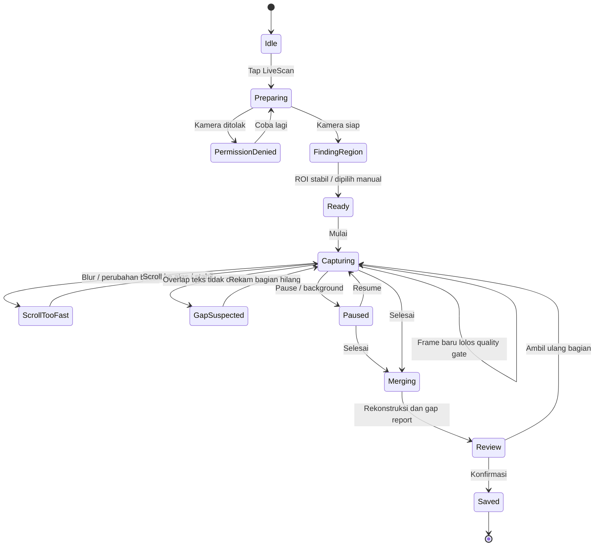

**Algoritme minimal LiveScan (pre-ONNX):**

1. `CameraImage` → frame quality metrics (focus via Laplacian variance, motion via inter-frame displacement, glare via histogram) → keep/skip.
2. ROI detect via contour/document outline **atau** manual quadrilateral; transform projective hanya jika empat titik valid; prefer manual bila deteksi gagal.
3. OCR async one-frame-in-flight, frame sampling adaptif (misalnya 1–2 FPS sebagai titik awal, bukan garansi), simpan normalized line text, bbox, timestamp, frame fingerprint.
4. Susun segmen berdasarkan beberapa frame stabil; normalisasi whitespace/case hanya untuk matching, pertahankan teks asli untuk bukti.
5. Temukan overlap dengan hashed n-grams, line alignment, fuzzy similarity; confidence rendah → `gap_possible`, jangan paksa merge.
6. Deduplicate hanya potongan yang dapat dipetakan ke token sequence posisi sebelumnya; jangan hapus kalimat identik di bagian berlainan tanpa konteks heading.
7. `Finish` → reconcile ordering, highlight gap, allow user edit & explicit “saya sudah cek”.
8. Simpan provenance: scan session/frame region/ocr method/segment order. Bila pengguna berhenti sebelum akhir, hasil `partial_scan`.

### F06 — Consent UI Image Collector dan Dark Pattern Detector

**Pra-ONNX:** impor screenshot, crop, anotasi manual elemen (`accept`, `reject`, `manage`, `checkbox`, `modal`, `text`), simpan gambar secara lokal hanya jika dipilih. Tidak ada klasifikasi dark pattern secara otomatis.  
**Pasca-ONNX:** mobile CV deteksi label terlatih; bila model gambar hanya menghasilkan klasifikasi seluruh screenshot, jangan menggambar bounding box palsu. Bounding box hanya untuk model deteksi/lokalisasi yang benar-benar terlatih dan diuji.  
**Output:** `ConsentUiCapture`, `UiElement`, `VisualFinding`.  
**Acceptance:** screenshot tanpa consent dialog → `not_applicable`; confidence di bawah threshold → `uncertain`; rekomendasi memerlukan bukti visual.

### F07 — ConsentGap AI

**Pra-ONNX:** UX membandingkan dua sumber dalam satu layar, menampilkan status `model_pending` dan “tambahkan sumber”; tidak memunculkan hasil AI.  
**Pasca-ONNX:** model NLI dan aturan domain menggunakan `PermissionSnapshot` + `PolicyClause`; label akhir `aligned`, `underspecified`, `not_found`, `contradicted`, `unverifiable` **hanya setelah** dataset dan label 5 kelas benar-benar tervalidasi. Jika notebook hanya melatih NLI tiga kelas, keluaran tetap 3 kelas dan heuristik domain terpisah diberi asal `rule_based` dengan pengujian.  
**Matching:** mapping permission → data-purpose ontology, retrieval kandidat klausa, model relation, rationale source-linked, penolakan bila source kurang.  
**Acceptance:** `not_found` tidak otomatis jadi `contradicted`; klausa versi/dokumen berbeda tidak digabung; selalu ada bukti untuk hasil non-unverifiable.

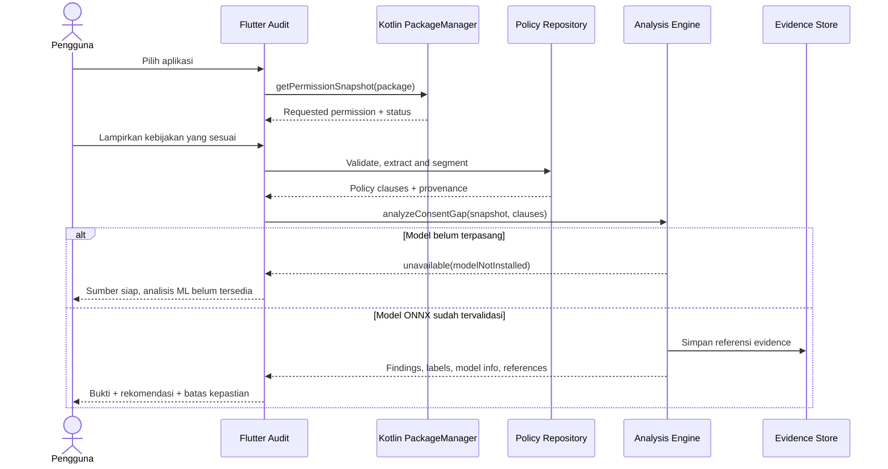

### F08 — Privacy Risk Analysis

Sebelum ONNX: **tidak ada skor probabilistik yang diklaim dari model**. Tampilkan indikator faktual seperti “izin lokasi diberikan”, “dokumen belum ditinjau”, “screenshot tersedia”. Sesudah ONNX, skor (jika dipakai) harus punya rumus tetap, versi rubric, metode validasi, arti skala, dan kalibrasi; bukan disamakan dengan peluang pelanggaran.  
**Acceptance:** model tak tersedia → tanpa score; kategori risiko didukung kriteria terbitan internal/hasil evaluasi.

### F09 — Evidence-Based Explanation

**Fungsi:** kartu bukti berisi temuan, kutipan maksimal sesuai dokumen, sumber (page/section/scan frame), highlighted bbox, versi analisis, OCR correction trail. **Acceptance:** pengguna bisa membuka sumber asli atau cuplikan yang tersimpan, mengetahui kalau screenshot asli tidak disimpan, dan melihat kutipan relevan.

### F10 — Smart Recommendation dan Privacy Action Center

**Pra-ONNX:** aturan deterministik dari jenis izin dan kondisi grant, seperti “buka Settings untuk meninjau izin lokasi”, dengan bahasa netral. **Pasca-ONNX:** rekomendasi dari kombinasi temuan; jangan menyarankan tindakan otomatis tak didukung OS.  
**Actions:** `openAppSettings`, `reviewPolicySection`, `redoScan`, `dismissFinding`, `export`, `deleteReport`. **Acceptance:** membuka Settings dan re-audit status usai pengguna kembali; tanpa toggle izin pihak ketiga palsu.

### F11 — Riwayat, laporan PDF, berbagi, dan penghapusan

**Fungsi:** daftar audit, filter sumber, status, tanggal; local-first persist; export PDF dengan header sumber, waktu, temuan, evidence, batasan, tipe analisis; share via OS; delete soft/physical sesuai pilihan. **Acceptance:** export berfungsi offline; laporan preview menandai “Belum dianalisis AI” bila demikian; file temp dibersihkan.

### F12 — Profil, Supabase Auth + Sinkronisasi opt-in

**Perubahan v3:** S21 `/profile` adalah layar tab kelima: dalam mode tamu tetap menampilkan penggunaan lokal, status simpan, kontrol data, bantuan dan kebijakan; masuk/daftar hanya tombol opsional. Pemilihan sinkronisasi tetap opt-in dan dokumen mentah tidak diunggah diam-diam.


Guest default. Pengguna dapat membuat akun untuk menyinkronkan metadata dan hasil yang dipilih; dokumen mentah dan screenshot tidak auto-sync. Auth email OTP atau password (pilih satu untuk MVP agar sederhana); logout bersihkan token; akun dapat menghapus cloud records. `RLS` wajib pada setiap tabel user-owned dan private bucket. **Acceptance:** user A tidak dapat membaca/ubah hasil user B; sync konflik tidak menimpa suntingan terbaru tanpa resolusi.

### F13 — Aksesibilitas dan keamanan

Text scaling, talkback label, target sentuh 48dp, state bukan hanya warna, privacy indicator kamera, tombol stop kamera jelas. Tangani redaksi PII saat share. Tidak merekam layar laptop dari OS ponsel; LiveScan memakai kamera dan izin pengguna. `FLAG_SECURE` pada layar KONSENA hanya opsional karena pengguna mungkin perlu screenshot bukti sendiri.

### F14 — ONNX Runtime Integration (FASE PALING AKHIR)

**Batas mulai:** seluruh F01–F13 relevan dan tests baseline lulus; model release bundle dari Kaggle tersedia dengan hash, tokenizer, label map, normalization, input shapes/opset, thresholds, eval metrics.  
**Integrasi:** Kotlin `onnxruntime-android` via Flutter `MethodChannel` atau native plugin; `InferenceService` menjalankan tokenization dan tensor conversion sesuai kontrak, mengembalikan prediksi beserta versi dan provenance. Jangan menganggap semua model nyaman berjalan pada device 4GB RAM; uji latency, memori, suhu, cold start pada perangkat fisik.  
**Acceptance:** parity test ONNX-vs-PyTorch; tensor shapes benar; label mapping identik; model gagal load → graceful unavailable; tidak ada UI palsu.

---
## 8. Use case diagram dan pemisahan aktor

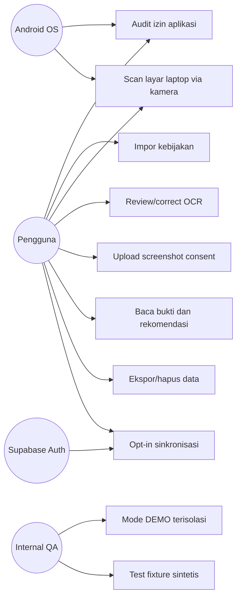

**Hak akses:** satu role produk `user`; `guest` punya data lokal saja. Role `internal_qa` tidak memperoleh hak membaca konten pengguna asli. Tidak perlu admin panel pada fase pertama. Bila ada admin untuk monitoring model, hanya gunakan metrik anonim dan akun yang memberi izin secara eksplisit.

---

## 9. Model data, entitas dan ERD

### 9.1 Aturan identitas data

- UUIDv4/UUIDv7 untuk `audit_id`, `document_id`, `scan_id`, `finding_id` dan `evidence_id`; UUID lokal berlaku tanpa internet.
- `user_id` nullable untuk guest dan hanya ada pada salinan cloud saat pengguna memilih sync.
- Semua data bukti tersambung ke `source_id`, `source_hash`, `capture_at`, dan `source_type`.
- `model_version` kosong untuk hasil manual/rule-based; wajib untuk setiap keluaran ONNX.
- `permission_snapshots` adalah waktu tertentu, tidak pernah menjadi record perubahan otomatis.
- `document_sections` menyimpan teks yang sudah dikonfirmasi dan metadata; `ocr_lines` menyimpan asal ekstraksi/koreksi.
- `confidence` boleh NULL, **bukan** otomatis 100% jika model tidak memberi skor.

### 9.2 ERD domain utama

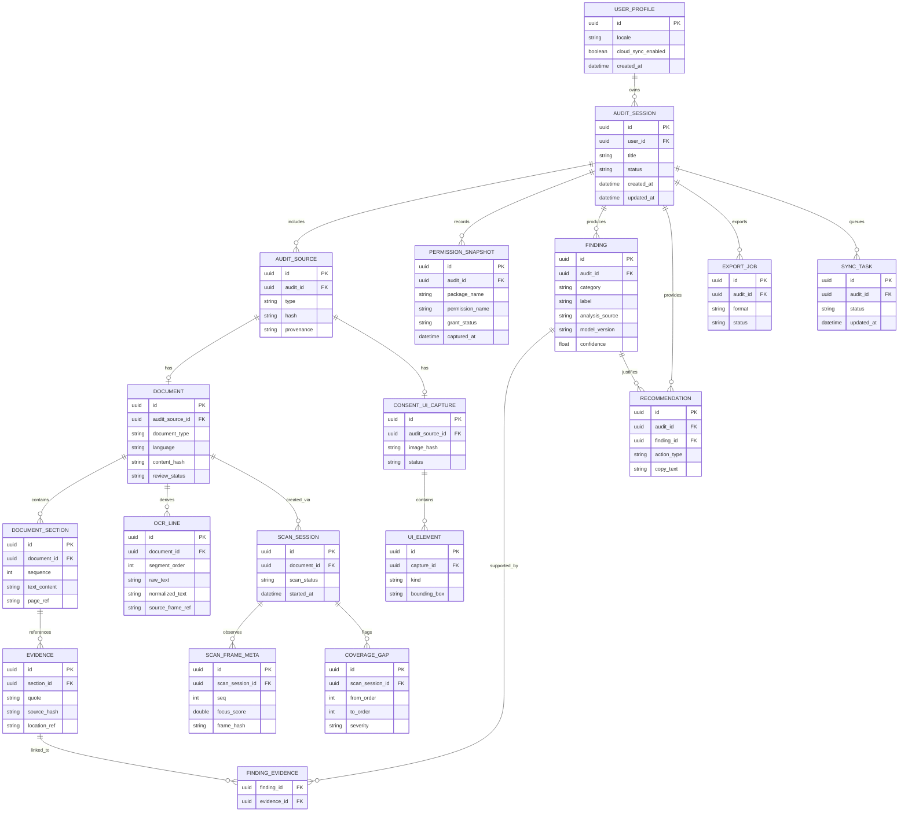

**Penting:** ERD mencakup entitas lokal logis; tidak semua `SCAN_FRAME_META`, OCR sensitif, dan raw docs harus dipindahkan ke Supabase. Cloud adalah subset eksplisit. Untuk guest data bisa tetap seluruhnya lokal.

### 9.3 Skema model objek minimum

```json
{
  "auditId": "uuid",
  "sourceTypes": ["android_permission", "policy_document", "consent_ui"],
  "permissionSnapshot": {
    "packageName": "com.example.shop",
    "androidSdk": 36,
    "capturedAt": "2026-11-07T08:00:00+07:00",
    "requestedPermissions": [
      {"name": "android.permission.ACCESS_FINE_LOCATION", "grantStatus": "granted", "protectionLevel": "dangerous"}
    ]
  },
  "policyDocument": {
    "documentId": "uuid",
    "documentType": "privacy_policy",
    "reviewStatus": "reviewed",
    "language": "id",
    "sourceHash": "sha256"
  },
  "analysis": {
    "status": "unavailable",
    "reason": "model_not_installed",
    "engineType": "none",
    "findings": []
  }
}
```

Semua nilai contoh di atas adalah ilustrasi kontrak dan **bukan output pemindaian nyata**.

### 9.4 Storage dan kebijakan retensi

| Objek | Default | Jika user aktifkan penyimpanan / cloud |
|---|---|---|
| Raw kamera / video | tidak disimpan, hanya buffer | tidak ada fitur cloud video MVP |
| Screenshot frame LiveScan | cache temporer, hapus setelah OCR | dapat dipilih untuk bukti lokal |
| Teks OCR review | lokal sampai dihapus | dapat dipilih untuk sync sebagai dokumen privat |
| Snapshot izin Android | lokal | sync hanya saat dipilih |
| File PDF asli | read-only temp; hapus setelah ekstraksi | opsional “simpan dokumen” |
| Hasil analisis/temuan | lokal | sync metadata/temuan setelah opt-in |
| Log diagnostik | tanpa data isi dokumen | telemetry teragregasi opt-in |

**Tidak menjanjikan “terenkripsi lokal” tanpa implementasi:** default file sensitif di cache sementara. Jika penyimpanan permanen dipilih, gunakan file terenkripsi AES-GCM dengan kunci Android Keystore dan uji restore/kehilangan kunci. Drift SQLite tidak otomatis terenkripsi; jika menyimpan konten OCR di SQLite, tambahkan enkripsi di level field/file atau pilih hanya metadata di DB.

---

## 10. Urutan pemrosesan LiveScan detail

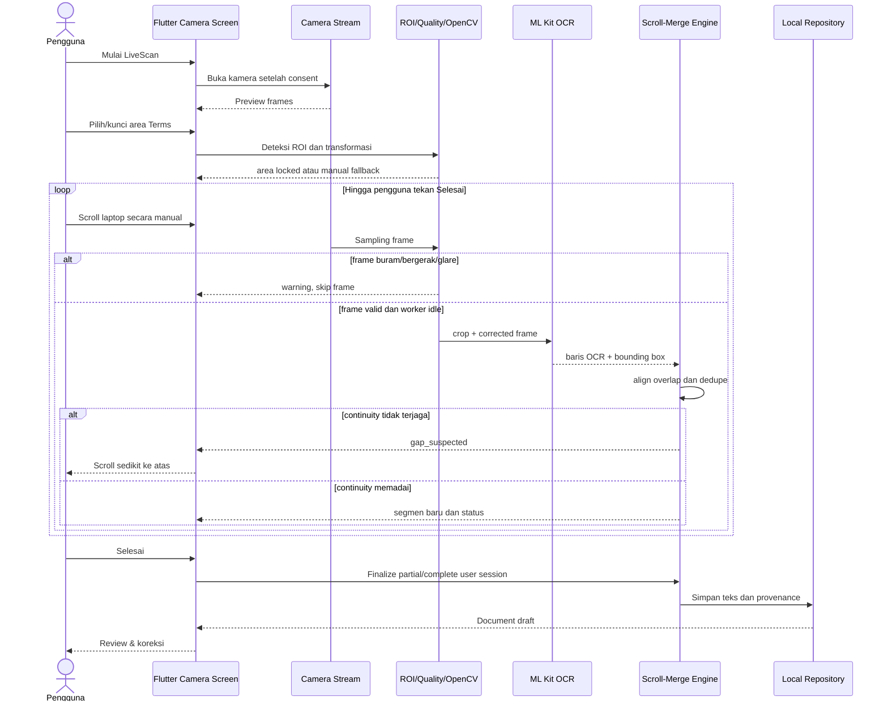

### 10.1 Logika kualitas kamera

- **Fokus:** estimator variance of Laplacian pada ROI; threshold ditentukan empiris pada beberapa kamera.
- **Motion:** perbedaan frame/optical flow; hindari OCR saat teks bergerak karena scroll.
- **Glare:** area saturasi berlebih; minta sudut monitor/kamera diubah.
- **Moiré:** kurangi dengan jarak/angle/quality filter; tidak menjanjikan eliminasi total.
- **ROI:** kontur persegi/quad dokumentasi; manual adjust adalah fallback permanen.
- **Frame scheduler:** satu OCR task aktif, backpressure, drop stale frames; hindari menumpuk 30 FPS ke OCR.
- **Scroll:** jangan infer scroll dari kamera jika ponsel bergerak banyak; minta stabilisasi/holder; fitur boleh tetap bekerja dengan handheld namun akurasi lebih rendah.

### 10.2 Merge invariant

1. `segment_index` monoton naik tetapi dapat direvisi saat user koreksi.
2. Teks berbeda yang mirip tidak otomatis terhapus; keputusan dedup menyimpan event dan skor similarity.
3. Setiap paragraf hasil merge dapat ditelusuri ke setidaknya satu OCR source frame atau sumber teks PDF.
4. Hasil gap `possible_missing_text` disimpan dan terlihat di review.
5. `finish` tidak berarti `entire_terms_captured`; only `scan_session_finished`.
6. Jika OCR confidence API tidak tersedia atau tidak reliabel, tampilkan “perlu ditinjau” dari heuristik kualitas, bukan confidence model yang dibuat-buat.

### 10.3 Kriteria uji kamera tahap awal

Gunakan minimal 3 kategori perangkat (kelas entry, mid, high) pada Android berbeda dan 3 jenis laptop/monitor bila tersedia. Dataset uji dibuat dari dokumen yang secara hukum boleh diproses dan teks ground truth. Uji setidaknya: 10 dokumen pendek, 10 menengah, 10 panjang; variasikan font, cahaya, sudut, gerakan kamera dan scroll. Target rekayasa awal (bukan klaim tercapai):

- Crash-free scan sessions ≥ 99% pada set pengujian internal.
- Normalized OCR CER/WER diukur, **target disesuaikan hasil baseline**, bukan mengarang angka akurasi final.
- Missing paragraph rate dan duplicate line rate wajib dilaporkan terpisah.
- Deteksi gap menunjukkan hasil jelas; pengguna bisa memperbaiki/memindai ulang.
- Durasi OCR/pemakaian baterai dimonitor sebagai NFR sebelum optimasi.

---

## 11. State machine audit, dokumen, dan sync

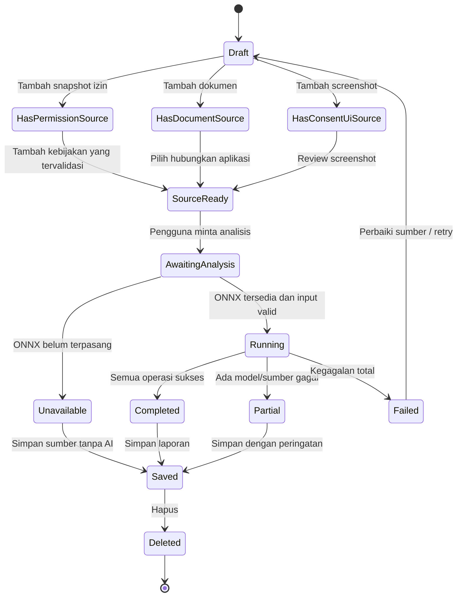

**State `Draft` bukan error;** pengguna bisa menyimpan hanya izin, dokumen, atau screenshot sebagai audit parsial. Penyatuan sumber tidak wajib selama tujuan pengguna masih bisa dicapai.

---

## 12. Privacy, threat model, dan keamanan

### 12.1 Threats yang perlu mitigasi

| Ancaman | Mitigasi minimum | Pengujian |
|---|---|---|
| Pengumpulan daftar aplikasi tanpa konteks | hanya launcher-visible, disclosure, pilihan audit | audit manifest/policy |
| Upload otomatis gambar sensitif | local-first, cloud opt-in per dokumen | intercept network test |
| Data cloud lintas pengguna | JWT + RLS + grants, private storage bucket | user A/B test |
| Kebocoran token | secure storage, jangan log | static scan |
| File PDF malicious/zip bomb | max size/page, MIME sniffing, parser sandbox/error guards | fuzz fixtures |
| OCR mengubah makna | highlight uncertainty + user review | ground truth test |
| LLM/model hallucination | evidence IDs mandatory; deterministic fallback; model unavailable state | contract test |
| Audit salah menandai pelanggaran | disclaimer, label potensi, human review | content review |
| Kebocoran raw camera | buffer transient, clear on dispose | disk inspection |
| Cloud delete tak tuntas | cleanup storage object & DB + async confirmation | deletion test |
| Model asset diganti/tampered | signed hash/SHA-256 verify, model version | tampered asset test |
| Permission bridge abuse | validate package input, no hidden query-all | Android instrumentation |
| Screenshot persetujuan palsu | jelaskan hanya indikasi dari visual yang disediakan | UI copy review |

### 12.2 Data minimization & consent

- Data user tidak digunakan otomatis untuk dataset training.
- Tidak ada penjualan daftar aplikasi, fingerprinting, atau monetisasi dari isi audit.
- Analytics produk agregat tanpa teks kebijakan, izin rinci, hash yang mudah dihubungkan ke identitas, atau gambar pengguna.
- Cloud sync/off-device ML memakai consent terpisah dan dapat ditarik kembali.
- Data deletion meliputi rows, Storage objects, cache temporary, serta catatan backup retention di policy layanan.
- Dokumen user mungkin memuat data pribadi/kredensial. Pengguna perlu preview sebelum export/share.
- Sediakan privacy policy KONSENA sendiri dan halaman pengaduan/kontak serta penjelasan batas klaim.

### 12.3 Diagram trust boundary

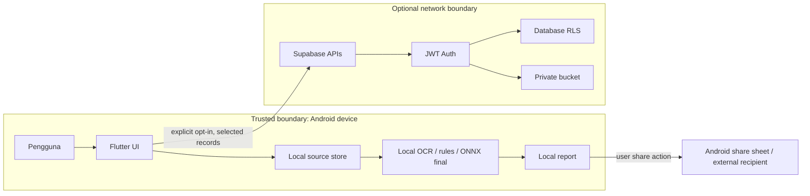

### 12.4 Perlindungan data dan kepatuhan

Indonesia: prinsip transparansi, pembatasan tujuan, keamanan data, hak subjek data yang relevan dengan UU No. 27 Tahun 2022 tentang Perlindungan Data Pribadi. PRD ini bukan pendapat hukum. Sebelum rilis, cek lagi persyaratan Google Play Data Safety, Privacy Policy publik, SDK disclosures dan regulasi yang berlaku.

---

## 13. Supabase: fondasi disiapkan Phase 00; penggunaan cloud pengguna tetap opsional

### 13.1 Tabel cloud subset

**Implementasi bertahap:** Pada Phase 00 Claude Code membangun project Supabase lokal, migrations SQL, kebijakan RLS, Storage privat, client gateway Flutter dan pengujian isolasi user. Ini adalah **persiapan infrastruktur**, bukan upload otomatis. Pada Phase 07 barulah login opt-in, seleksi sync, conflict/queue/retry dan penghapusan cloud diimplementasikan. Jika remote belum ada, local migration boleh diverifikasi tanpa klaim remote selesai.

- `profiles`: owner uid, locale, privacy preferences.
- `audit_records`: owner uid, title, status, created/updated, source summary; **tidak wajib** memuat teks penuh.
- `audit_sources`: type, safe metadata, SHA-256 optional, `storage_path` hanya jika dipilih.
- `findings`: label, summary, engine_type, model_version, evidence references; boleh kosong sebelum ONNX.
- `recommendations`: text, status, origin (`rule_based` atau `ml`).
- `evidence_refs`: excerpt yang user opt-in sync; limited length.
- `sync_devices`: per-device cursor and last_sync_at (opsional).

`owner_id = auth.uid()` di semua child row. Untuk nested relationships, jangan hanya mengandalkan FK: pastikan permission berdasar owner_id atau join parent yang terikat uid. Bucket `konsena-private` tanpa public URL.

### 13.2 Sync strategy

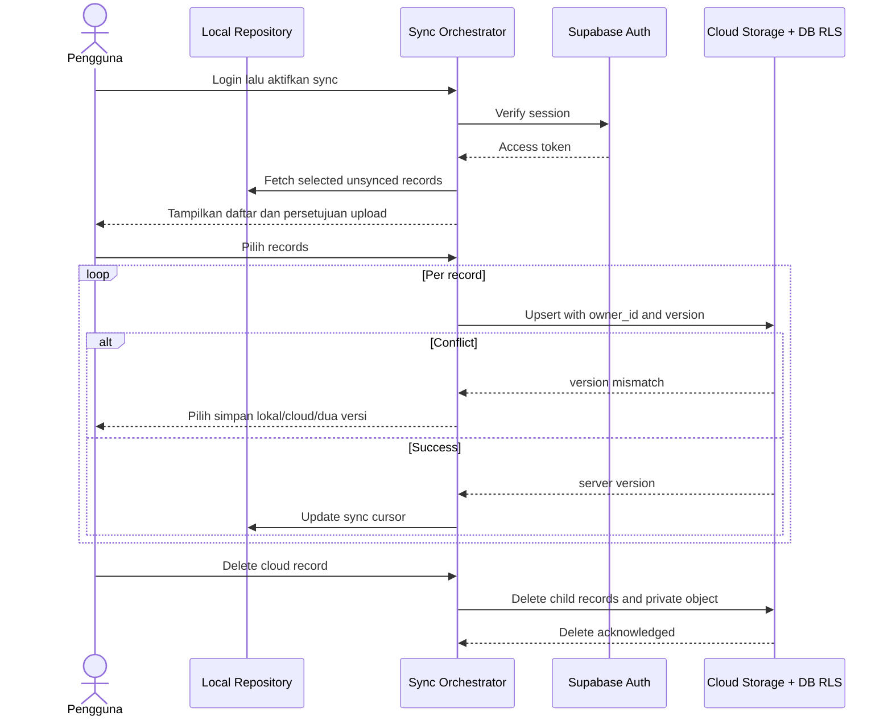

### 13.3 Contoh RLS principles (lihat migrasi SQL di paket)

- Deny-by-default grants; `authenticated` minimal.
- All owned tables `ENABLE ROW LEVEL SECURITY`.
- `SELECT/INSERT/UPDATE/DELETE` masing-masing memvalidasi `owner_id = auth.uid()` dan `WITH CHECK`.
- Storage object path dibatasi `auth.uid()/...`, tidak ada bucket publik.
- Tidak ada service-role token di APK.

Sumber: [Supabase RLS](https://supabase.com/docs/guides/database/postgres/row-level-security), [Supabase Storage RLS](https://supabase.com/docs/guides/storage/security/access-control).

---

## 14. Contract-first analysis engine dan skema model release

### 14.1 Interface responsibility

`PermissionRepository` → snapshot Android; `DocumentRepository` → section & provenance; `LiveScanRepository` → scan session; `AnalysisEngine` → model output; `EvidenceRepository` → source-level evidence; `RecommendationService` → aturan yang dapat diaudit; `ReportRepository` → PDF/local. Tidak ada tight coupling antar widget.

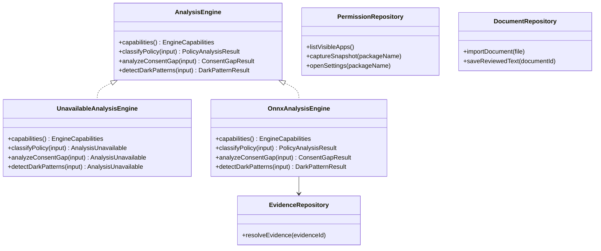

### 14.2 Model manifest contract (akan dipakai fase terakhir)

```json
{
  "schema_version": "1.0.0",
  "release_id": "example-release-only",
  "model_id": "policy_classifier",
  "model_version": "unset_until_training",
  "engine": "onnxruntime_android",
  "model_file": "model.onnx",
  "sha256": "REPLACE_WITH_REAL_SHA256",
  "opset": null,
  "inputs": [{"name": "input_ids", "dtype": "int64", "shape": [1, 256]},
             {"name": "attention_mask", "dtype": "int64", "shape": [1, 256]}],
  "outputs": [{"name": "logits", "dtype": "float32", "shape": [1, "num_labels"]}],
  "preprocessing": {"tokenizer_file": "tokenizer.json", "max_length": 256, "truncation": true},
  "labels_file": "labels.json",
  "thresholds_file": "thresholds.json",
  "model_card_file": "model_card.md",
  "evaluation_report_file": "metrics.json"
}
```

Contoh di atas **bukan kontrak final model tertentu**. Claude Code harus membaca signature `model.onnx` nyata dari Kaggle; jika shape dinamis, tipe int32, input token_type_ids, atau image tensor berbeda, gunakan manifest sesuai model tersebut. Jangan hard-code `input_ids` untuk model CV.

### 14.3 Contract result

```json
{
  "status": "completed",
  "engineType": "onnx",
  "modelVersion": "trained_actual_version",
  "task": "policy_classification",
  "sourceIds": ["document-id"],
  "findings": [
    {
      "findingId": "uuid",
      "label": "third_party_sharing",
      "confidence": null,
      "evidenceIds": ["evidence-id"],
      "reviewRequired": true
    }
  ],
  "warnings": []
}
```

Prediksi tanpa `evidenceIds` wajib diubah menjadi `unverified` atau dikeluarkan dari hasil utama sesuai aturan task. Asumsi model menghasilkan confidence harus dibuktikan dengan kalibrasi.

### 14.4 Pipeline ONNX (final)

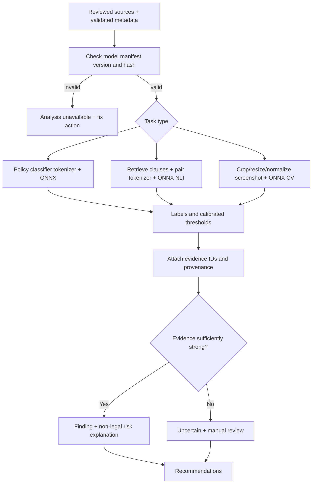

### 14.5 Integrasi ke Flutter

- Kotlin bridge `id.konsena/onnx`: `loadModel({modelId})`, `runInference({task, requestId, payload})`, `getModelInfo()`, `disposeModel()`.
- Operations must be off main thread; cancellation support and backpressure.
- Tokenization bisa Kotlin library/HuggingFace compatible implementation yang diuji dengan reference tokens dari Kaggle; jika tokenizer unsupported, pertimbangkan Rust/C++/Dart tokenizer yang *verified*, jangan asal split whitespace.
- Model hashes diverifikasi saat load; model assets tidak berasal dari URL remote tanpa integrity/signature.
- Batas bundel model: jika APK terlalu besar, unduh on-demand dengan consent, cache, checksum, retry; tetap bisa audit tanpa model.
- NLI dan CV tidak harus dijalankan sekaligus jika perangkat terbatas; menunda inference lebih baik daripada OOM.

---

## 15. Algoritme rekomendasi, risiko, dan kualitas evidence

### 15.1 Aturan rekomendasi pra-ONNX yang legal secara produk

| Fakta yang diverifikasi | Saran yang boleh ditampilkan | Yang tidak boleh ditampilkan |
|---|---|---|
| Izin kamera granted | “Tinjau izin kamera di pengaturan aplikasi bila tidak dibutuhkan” | “Aplikasi merekam tanpa izin” |
| Izin kontak declared tetapi not granted | “Akses kontak saat ini tidak diberikan menurut snapshot” | “Data kontak aman sepenuhnya” |
| Dokumen tidak tersedia | “Tambahkan Privacy Policy untuk memeriksa penjelasan izin” | “Developer menutupi data” |
| Hasil OCR ada gap | “Ulangi pemindaian bagian ini atau koreksi teks” | “Dokumen berhasil terbaca 100%” |
| Screenshot consent ada tanpa model | “Simpan screenshot sebagai bukti untuk diperiksa” | “Dark pattern sudah ditemukan oleh AI” |
| Model tidak kompatibel | “Analisis AI belum tersedia pada perangkat ini” | Menunjukkan skor random |

### 15.2 Policy Risk rubric (setelah validasi)

Jika ingin menampilkan skor, buat dokumen `risk_rubric_v1.json` yang mendefinisikan:
- Dimensi: pengumpulan data, berbagi data, transparansi penjelasan, retensi, pilihan/opt-out, desain consent.
- Setiap skor dimensi dikaitkan dengan sumber evidence; bobot diset oleh tim dan diuji dengan reviewer, bukan distandarkan tanpa bukti.
- Skor bukan probabilitas pelanggaran atau indikator hukum; tampilkan label “indikator perhatian”, jangan menghakimi aplikasi.
- Unknown/no evidence tidak otomatis dinilai high risk.
- Rekam `rubric_version`, `inputs_used`, `missing_dimensions`, `calibration_status`.

### 15.3 Jenis keluaran temuan

- `factual`: langsung dari OS/teks OCR yang dikonfirmasi.
- `rule_based`: inferensi deterministik dari fakta.
- `ml_inferred`: hasil model dengan versioning, evaluated labels, confidence jika tersedia.
- `human_corrected`: koreksi pengguna yang tidak boleh mengubah file sumber secara diam-diam.

---

## 16. Non-functional requirements (NFR) dan target engineering

Angka berikut merupakan **target awal yang harus divalidasi**, bukan performa yang sudah dicapai.

| ID | Kategori | Target / kebutuhan |
|---|---|---|
| NFR-01 | Launch | cold start menuju beranda p50 < 3 detik pada target midrange, diukur release mode |
| NFR-02 | UI responsiveness | scroll daftar apps lancar, target 55–60 FPS pada perangkat uji midrange |
| NFR-03 | Availability | fitur utama offline tetap hidup; Supabase down tidak memblokir local audit |
| NFR-04 | Battery | kamera berhenti ketika route dispose/background; scan idle tidak berjalan di belakang layar |
| NFR-05 | Memory | streaming OCR one-in-flight; hindari seluruh raw frame buffer tersimpan |
| NFR-06 | Security | RLS test lintas user, no embedded service role key, no sensitive logs |
| NFR-07 | Accessibility | TalkBack, dynamic text, focus order, 48dp touch target |
| NFR-08 | Localization | Bahasa Indonesia utama; sumber teks Inggris tidak diterjemahkan secara diam-diam |
| NFR-09 | Recoverability | aplikasi dapat resume draft setelah crash/kill (metadata & teks yang telah disimpan) |
| NFR-10 | PDF | teks jelas, halaman tidak overflow, source citations terlihat |
| NFR-11 | ML | ONNX FP32/INT8 parity gate, supported operators, measurable latency/memory |
| NFR-12 | Transparency | setiap hasil terkait sourceID; label status analysis dan missing evidence |
| NFR-13 | Retention | tombol clear cache, hapus riwayat, delete cloud content (jika sync) |
| NFR-14 | Build quality | CI analyze/tests/build release; tidak ada blocker tinggi pada audit permission/privacy |

---

## 17. Test plan: sebelum dan sesudah ONNX

### 17.1 Pyramid pengujian

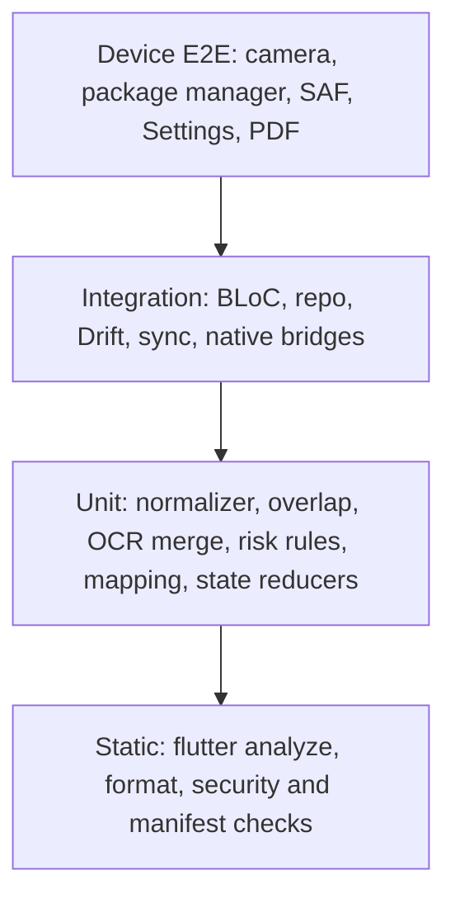

### 17.2 Test matrix wajib

| Area | Positive | Negative / recovery | Tool |
|---|---|---|---|
| Onboarding | guest mode | no network, skip account | widget/integration |
| Apps list | launcher apps visible | package hidden, uninstalled, profile | Android instrumentation |
| Permission snapshot | dangerous/normal, granted/not | no permissions, OEM exception | instrumentation |
| Settings | navigate and refresh | no activity handler | device E2E |
| PDF | embedded text | scanned PDF, encryption, malformed | fixtures |
| OCR image | clean text | glare, blur, rotated | golden image fixtures |
| LiveScan | slow scroll overlap | fast scroll, camera motion, pause/kill | real device E2E |
| Merge | de-dupe repeated frame | repeated clause different section | unit |
| Consent screenshot | crop/save/delete | non-consent image | widget/integration |
| Analysis pre-ONNX | unavailable UI | invalid/empty inputs | contract |
| Evidence | source jump & quote | missing source after delete | integration |
| PDF export | source summary & disclaimer | long text and no model | golden PDF |
| Cloud sync | explicit selected upload | RLS cross-user, revoked token | Supabase test |
| ONNX final | same PyTorch reference output | corrupted model, unsupported ops, OOM | parity/device |

### 17.3 Device matrix

- Android 10 / API29, Android 12 / API31–32, Android 14 / API34, Android 16 / API36 (perangkat/emulator jika tersedia).
- `minSdk 24` runtime smoke test tambahan minimal satu emulator/API24.
- 3 tier RAM perangkat target: 4GB, 6GB, 8GB+. Kamera fisik wajib; emulator saja tidak cukup.
- Test portrait, font scaling 1.3–2.0, light/dark, offline, battery saver, incoming call, background/resume.

### 17.4 CI/CD gate

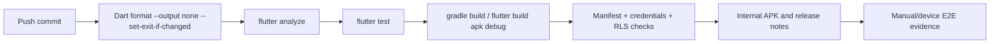

Sertakan skrip `scripts/verify.sh` yang berhenti jika ada kegagalan kritis, tidak mengabaikan exit code. Gunakan fixture sengaja mengandung dokumen korup untuk menguji penanganan error, bukan “menghalalkan error” dengan try/except terlalu luas.

---

## 18. Fase implementasi Claude Code (berurutan; ONNX terakhir)

**Definisi selesai setiap fase:** kode ter-commit, `flutter pub get`, `flutter analyze`, unit/widget tests, APK debug build jika toolchain tersedia, screenshot nyata atau widget-test, changelog, ADR keputusan penting, dan daftar blocker/known issues. Bila mesin Claude Code tidak punya Android SDK, tetap hasilkan kode dan unit tests lalu laporkan build Android `not_run`, bukan mengklaim lulus.

### PHASE 00 — Setup dan repo baseline

**Tugas:** create Flutter Android project, package ID unik, `minSdk 24`, `targetSdk 36`, dependencies kompatibel, flavors `dev/staging/prod`, `.env.example`, routes skeleton, theme, test harness, CI, lint rules, repo README.  
**Output:** app launch Android, navigasi dummy *tanpa fitur palsu*, repo rapi, running baseline.  
**Gate:** analyze + test + build, jika tersedia; no onnx package.

### PHASE 01 — Design system, navigation, dan seluruh layar (UI-first)

Dijalankan dalam tiga *gate* terpisah (`01A`, `01B`, `01C`). 01A membangun token, Splash, Onboarding, Privacy Setup dan dashboard S03 berdasarkan referensi; 01B membangun shell lima tab dan seluruh route S00–S39; 01C mengerjakan state, aksesibilitas dan golden test. **Jangan membuat tombol inert atau angka risiko palsu**. Prompt rinci ada di `prompts/PHASE_01A_*`, `PHASE_01B_*` dan `PHASE_01C_*`.


**Tugas:** tokens/typography/components, dark mode, screenshot reference, 24 routes, navigation guards, empty/loading/denied states; preview dengan fixtures bertanda DEMO dan toggle hanya di flavor internal.  
**Output:** semua halaman dapat dibuka, flow button wired ke route atau action valid.  
**Gate:** widget/golden tests semua halaman utama, accessibility labels; tidak ada dead button.

### PHASE 02 — Data domain, local repository dan audit project

**Tugas:** freezed/json DTO, Drift migrations, local storage, source linking, evidence references, audit draft status, history, deletion, app preferences, guest. Implement event/state BLoC dan services `UnavailableAnalysisEngine`.  
**Output:** create/save/reopen/delete audit dan dokumen draft bekerja offline.  
**Gate:** DB migration and repository test, restart app restore state.

### PHASE 03 — Native Android Permission Inspector

**Tugas:** Kotlin `MethodChannel`, launcher `queries`, `PackageManager` version-compatible, permissions snapshot, settings Intent, UI filter/search, handling Android visibility limits and all native errors.  
**Output:** audit nyata aplikasi terpilih dan refresh setelah kembali dari Settings.  
**Gate:** Android instrumentation di perangkat nyata, no `QUERY_ALL_PACKAGES`, status shown as fact not risk.

### PHASE 04 — Policy Scanner import, PDF extraction, OCR single image

**Tugas:** import PDF/JPEG/PNG/text; text extraction, OCR fallback, segmentation preserving original sections, review editor, hashing, unsupported handling, cancellation.  
**Output:** dokumen siap review dengan bukti dan sumber; tidak ada AI classification.  
**Gate:** fixtures PDF embedded/scanned/malformed and image OCR, no crash.

### PHASE 05 — LiveScan Computer Vision + OCR + scroll merge

**Tugas:** camera setup, ROI auto/manual, quality gate, ML Kit integration, frame backpressure, OCR overlap, gap detection, editing/retry, partial session save.  
**Output:** pengguna memindai Terms di monitor sambil scroll manual → merged text review.  
**Gate:** device E2E 3 contoh laptop view + dokumentasi missing paragraph/duplication; seluruh proses offline.

### PHASE 06 — Consent UI Screenshot, Evidence Explorer, Action Center

**Tugas:** screenshot capture/import, manual UI elements, evidence linking; explain permission facts with neutral rules; open Settings; source citations and jump-to-original; distinguish “not available”.  
**Output:** report faktual dan saran deterministik; belum ada deteksi dark pattern otomatis.  
**Gate:** every evidence resolves, no fabricated dark pattern/confidence.

### PHASE 07 — History, PDF Report, account, cloud sync opt-in, security

**Tugas:** PDF report with status labels, share, local deletion, auth optional, RLS migration/private bucket, cloud sync selection, conflict resolution, privacy policy and data deletion.  
**Output:** complete local MVP; cloud optional, failing network nonblocking.  
**Gate:** cross-user RLS test, offline export, delete cleanup, no tokens in logs.

### PHASE 08 — Product hardening, accessibility & pre-ML release candidate

**Tugas:** performance profiling, crashes, battery, large document limits, QA device matrix, secure data review, package visibility, review Play compliance, release signing internal, telemetry opt-in.  
**Output:** release candidate WITHOUT ONNX that functions honestly, documents feature flags.  
**Gate:** zero P0 blockers, complete regression, explicit ML unavailable user experience.

### PHASE 09 — INTEGRASI ONNX (TERAKHIR, BUKAN SEBELUMNYA)

**Prerequisite:** Kaggle model bundle yang benar-benar terlatih dan dievaluasi, memiliki `model.onnx`, tokenizer, input/output signatures, label map, thresholds, tests, SHA-256.  
**Tugas:** implement Kotlin ONNX adapter, tokenization parity, model manager, source mapping, model loading/cancellation; enable flags per task; update UI only for tasks yang sudah didukung model.  
**Gates:** on-device parity; regression end-to-end; model size/latency/memory measured; ML results evidence-linked; below-threshold output becomes uncertain; fallback on unavailable.  
**Expected artifact:** release package model-compatible and evaluated on target Android phones.

### PHASE 10 — Evaluasi pengguna dan final release

**Tugas:** usability testing, quantitative task success, consent comprehension before/after, error classification, vulnerability/privacy review, release notes, Play listing and privacy disclosures.  
**Gate:** user testing results and documented limitations; no unverified marketing claims.

### 18.1 Diagram dependensi fase

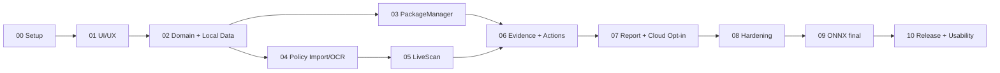

### 18.2 Phase outputs yang wajib diserahkan Claude Code

Setiap phase mengeluarkan `CHANGELOG_PHASE_xx.md`, `TEST_REPORT_PHASE_xx.md`, file sumber, test fixtures, dan screenshot/golden states yang relevan. Jika ada issue, buat `BLOCKERS.md` dan jangan menyamarkan unfinished feature dengan demo data. Setiap fase berjalan di repo yang sama (tidak membuat repo baru/duplicated apps). 

---

## 19. Data training dan integrasi notebook Kaggle

| Model/engine | Data sumber | Bentuk target | Catatan integrasi |
|---|---|---|---|
| Privacy policy clauses | APP-350 + OPP-115 (periksa lisensi dan mapping) | klasifikasi kategori klausul | model classifier mobile kecil, real label map |
| Indonesian NLI | IndoNLI | entailment/neutral/contradiction | bukan otomatis ConsentGap 5 label |
| ConsentGap domain | dataset anotasi `KONSENA-ConsentGap-ID` | label domain setelah divalidasi | tidak boleh dibuat label sintetis asal-asalan |
| Dark pattern CV | ContextRico-DP / AppRay | label screenshot/ROI sesuai dataset | dataset berbeda tak boleh disatukan label tanpa mapping |
| Live camera OCR | ML Kit OCR + evaluation frames buatan sendiri | teks + bbox, bukan ONNX | ukur CER/WER dan continuity |

**Model selection:** Kaggle 2×T4 training mempercepat beberapa eksperimen tetapi tidak berarti model paling akurat. Pilih berdasarkan Macro-F1, per-label recall, class imbalance, evidence quality, split by app/site, latency, model RAM, ukuran, dan zero-shot bahasa Indonesia. Target akurasi tinggi harus didukung held-out test, bukan dicantumkan sebagai hasil yang pasti.

**Model release bundle:** `policy_classifier/model.onnx`, `consent_nli/model.onnx`, `dark_pattern/model.onnx`, `tokenizer.json`, `labels.json`, `preprocessing.json`, `model_contract.json`, `metrics.json`, `checksums.sha256`, `license_compatibility.md`, `example_inputs_outputs.json`. **Jangan gabungkan dalam APK sebelum fase 09.**

---

## 20. Metode penilaian produk, rollout, risiko dan mitigasi

### 20.1 Product KPI & eksperimen pengguna

| KPI | Definisi | Sasaran awal, bukan hasil |
|---|---|---|
| Activation | persentase pengguna yang berhasil menyelesaikan audit atau scan | ukur setelah beta |
| Scan completion | scan sessions yang berakhir dengan reviewed text | ≥70% sebagai target uji eksploratif |
| OCR edit burden | persentase token diedit per dokumen | laporkan, turunkan lewat optimasi |
| Evidence usefulness | % peserta yang dapat menemukan sumber klaim | ≥80% target usability |
| Action success | % pengguna bisa membuka Settings dari rekomendasi | ≥95% pada perangkat uji |
| Privacy comprehension | kenaikan skor kuis pemahaman sebelum/sesudah | diukur, jangan janjikan peningkatan |
| Crash-free sessions | jumlah sesi tanpa crash/total | ≥99% target beta |
| ML Macro-F1 | metrik held-out untuk task dan label terpisah | berdasarkan benchmark nyata |

### 20.2 Risiko produk dan keputusan

| Risiko | Severity | Penanganan |
|---|---|---|
| Model ONNX besar / OOM | Tinggi | defer integrasi, memory budget dan quantization gate |
| Izin Android tak terlihat | Tinggi | scope launcher-visible + disclosure + document-only fallback |
| LiveScan gagal pada layar glossy/moiré | Tinggi | manual ROI, pause/rescan, text review |
| Terms berbeda dari Privacy Policy | Tinggi | tandai source type, minta privacy policy untuk consent audit |
| OCR menggandakan/melewatkan kalimat | Tinggi | merge audit trail, gap warnings, review |
| False positive dark pattern | Tinggi | model-specific thresholds, manual review, evidence overlay |
| ConsentGap kekurangan anotasi | Tinggi | engine unavailable untuk label domain tak tervalidasi |
| Ketergantungan internet | Sedang | offline-first; Sync P1 |
| Penyimpanan data sensitif | Tinggi | ephemeral default, encrypt opt-in persist, RLS cloud |
| Perubahan package/API Android | Sedang | CI matrix dan native bridge abstraction |
| Lisensi dataset/model | Tinggi | audit lisensi dataset, model weights, ONNX distribution |

### 20.3 Rilis bertahap

- **Internal Alpha:** phases 00–05, kamera dan permission tested pada tim.
- **Closed Beta pre-ML:** phases 06–08, full local feature set, analysis ML unavailable disebut jelas.
- **Closed Beta ONNX:** phase 09, model teruji, explicit opt-in data & model downloads jika besar.
- **Public release:** phase 10 setelah review privacy security, Play policy, usability dan crash/performance.

---

## 21. Definisi Done final

- [ ] Setup Flutter/Android dapat diulang di mesin baru dengan README.
- [ ] Semua route, CTA, error/empty/loading states fungsional.
- [ ] Permission Inspector diuji perangkat Android sebenarnya.
- [ ] PDF/image/text import dan OCR offline berjalan.
- [ ] Live camera scan layar laptop + scroll merge + gap handling + review berjalan.
- [ ] Consent screenshot collection + evidence review nyata.
- [ ] Audit report dengan bukti/provenance dan rekomendasi rule-based berjalan tanpa ONNX.
- [ ] Riwayat, PDF, delete, privacy preferences berfungsi offline.
- [ ] Sync cloud opt-in + RLS tests (jika fitur diaktifkan).
- [ ] UI pra-ML menampilkan unavailable, bukan skor fiktif.
- [ ] ONNX ditambahkan hanya di fase final setelah manifest, parity dan device profiling lulus.
- [ ] Dokumentasi known limitations, privacy policy, licenses, model card, release notes disediakan.

---

## 22. Dokumen yang harus tersedia pada repository

1. `PRD_KONSENA_AI_MOBILE.md` (dokumen ini).
2. `docs/DESIGN_SYSTEM.md` (palette, components, states, 24 routes).
3. `docs/IMPLEMENTATION_PHASES.md` (daftar pekerjaan P00–P10 + tests).
4. `docs/adr/*.md` (keputusan teknologi/risiko).
5. `contracts/analysis_engine_contract.json` dan `contracts/permission_snapshot_schema.json`.
6. `database/supabase_schema.sql` (P1 cloud subset dan RLS).
7. `diagrams/*.mmd` (diagram siap render).
8. `CLAUDE.md` (aturan implementasi dan gate).

---

## 23. Referensi teknis dan kepatuhan (diverifikasi 7 Nov 2026)

- Android package visibility: https://developer.android.com/training/package-visibility
- Android manifest queries: https://developer.android.com/training/package-visibility/declaring
- Android PackageInfo `requestedPermissions`: https://developer.android.com/reference/android/content/pm/PackageInfo
- Android Settings Intent: https://developer.android.com/reference/android/provider/Settings
- Google Play installed app visibility restrictions: https://support.google.com/googleplay/android-developer/answer/16558241
- Google Play Android 16 target requirement 2026: https://support.google.com/googleplay/android-developer/answer/11926878
- Flutter camera: https://pub.dev/packages/camera
- ML Kit Text Recognition v2: https://developers.google.com/ml-kit/vision/text-recognition/v2/android
- Supabase Flutter quickstart: https://supabase.com/docs/guides/getting-started/quickstarts/flutter
- Supabase RLS: https://supabase.com/docs/guides/database/postgres/row-level-security
- Supabase Storage access control: https://supabase.com/docs/guides/storage/security/access-control
- ONNX Runtime mobile: https://onnxruntime.ai/docs/tutorials/mobile/

**Catatan:** versi paket berubah; setelah fase setup, daftar versi nyata harus disimpan di lockfiles dan `ENVIRONMENT.md`. Keberhasilan aplikasi/akurasi ML belum dibuktikan sampai pengujian nyata. Dokumen ini merupakan spesifikasi, bukan klaim fitur telah dibangun.


## Lampiran V2 — Palet warna final

Palet UI identitas final adalah Midnight Purple `#252148`, Deep Indigo `#342D61`, Royal Violet `#5A3DAD`, Electric Violet `#7838D8`, Lavender `#C4BDD6`, Soft Lilac `#E5E0F9`, Pale Lavender `#EFE6FB`, Cloud White `#FDFCFE`; success `#36C77B`, warning `#FFB83F`, danger `#EF6464`. Semua implementasi harus mengikuti `DESIGN_SYSTEM.md`. Gunakan aset logo ungu transparan `assets/brand/konsena_mark_transparent.png`; larang logo teal dari desain lama. Aset disediakan sebagai referensi brand, bukan sebagai bukti kepemilikan merek.


## Lampiran V3 — Sinkronisasi dengan UI Stitch dan Claude Code

1. **Prioritas referensi:** PRD untuk perilaku dan scope, `DESIGN_SYSTEM.md` untuk warna/komponen, `DESIGN_REFERENCE_MAPPING.md` untuk pemetaan sumber Stitch, `KONSENA_AI_PAGE_BY_PAGE.md` untuk route, `IMPLEMENTATION_PHASES.md` untuk gate fase, `CLAUDE.md` + `prompts/` untuk eksekusi.
2. **Screen sumber sebenarnya:** Splash `s00_splash_screen/code.html`; onboarding `s01_onboarding/code.html`; Dashboard `01_dashboard/code.html` + `screen.png`. Halaman lain S02, S04–S39 **tidak ada dalam ZIP** dan harus dirancang konsisten, bukan diklaim sebagai salinan Stitch.
3. **Bottom navigation:** Beranda / Audit Baru / Pindai / Riwayat / Profil; S21 `/profile` termasuk guest mode. `/account` alias route lama saja.
4. **Tidak ada hasil AI sebelum model nyata:** preview, status `belum tersedia`, contoh hanya pada `demo` flavor berlabel jelas. Angka 0 pada dashboard bersumber dari query lokal kosong, bukan angka demo yang di-hardcode pada produksi.
5. **Menjalankan Claude Code:** mulai langsung dari **prompt fase 00** `prompts/PHASE_00_REPO_SUPABASE.md`, lalu lanjutkan daftar di `prompts/README.md` **satu per satu**. `CLAUDE.md` dibaca sebagai aturan proyek, bukan master prompt. Phase 00 wajib setup repository Flutter + Supabase; Phase 07 baru mengimplementasikan sync opt-in. ONNX hanya Phase 09 setelah artefak valid.
